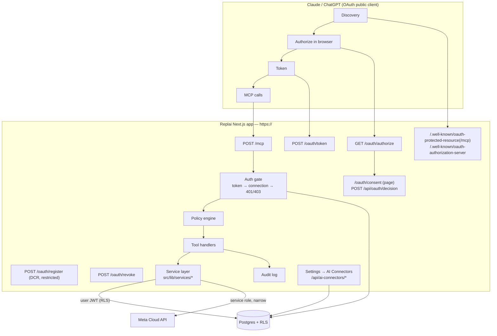
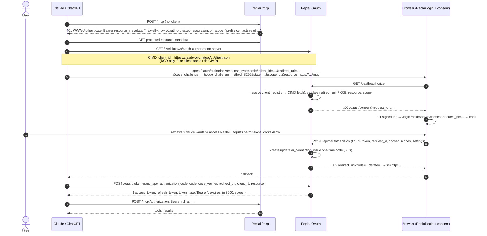
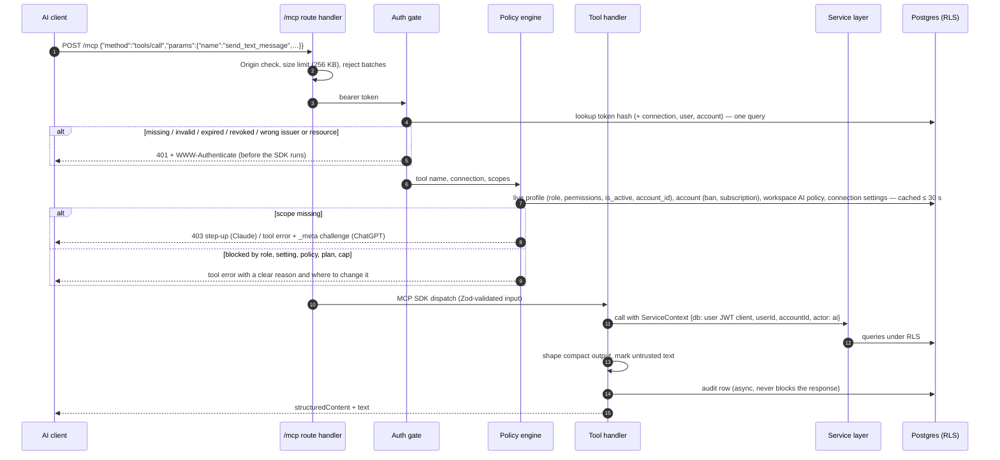
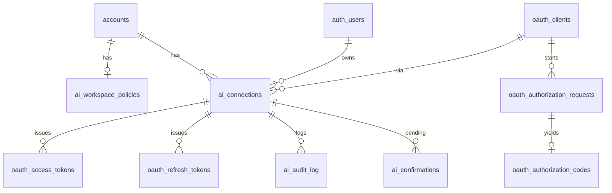

# 01 — Architecture

How the connector is put together: the components, the OAuth flows, the
token model, how a tool call executes, the database tables and where the
code lives.

> **Before writing code:** this repo runs Next.js 16 (`proxy.ts`, not
> `middleware.ts`). Per `AGENTS.md`, read the relevant guides in
> `node_modules/next/dist/docs/` for route handlers, `proxy`, rewrites and
> dynamic route segments before implementing anything below.

---

## 1. What exists today and what we reuse

| Existing piece                                                        | Reuse                                                                                             |
| --------------------------------------------------------------------- | ------------------------------------------------------------------------------------------------- |
| Supabase cookie login (`/login`, `getCurrentAccount`)                 | The consent page signs the user in exactly like the dashboard does                                |
| RLS through `is_account_member(account_id, role)`                     | Tool calls run as the user, so tenant isolation comes from the same 147 policies                  |
| `MemberPermissions` + `hasSectionAccess` (`roles.ts`)                 | Live per-member capability checks on every tool call                                              |
| `/api/v1/*` helpers (`src/lib/api/v1/*`)                              | `findOrCreateContact`, `setContactTags`, serializers, pagination cursors                          |
| WhatsApp send paths (`/api/whatsapp/send`, v1 messages, broadcasts)   | Extracted into shared service functions so the dashboard and the connector send the same way      |
| Subscription gate (`resolveSubscriptionState`, `getCachedGateConfig`) | The same verdict blocks AI calls for lapsed or banned workspaces                                  |
| `checkRateLimit` (`src/lib/rate-limit.ts`)                            | Per-connection and per-account limits (single container, so in-memory is fine)                    |
| Webhook SSRF guard (`src/lib/webhooks`)                               | Reused for fetching Client ID Metadata Documents                                                  |
| `@modelcontextprotocol/sdk` 1.30 (already a dependency)               | Server, Zod tool schemas, `WebStandardStreamableHTTPServerTransport`                              |
| `mcp-server/` (stdio, API key)                                        | Kept as-is for self-hosters and scripts (D12). Its tool definitions are a starting reference only |

New pieces: an OAuth 2.1 authorization server, a remote MCP endpoint, a
policy engine, the AI Connectors settings page and the supporting tables.

---

## 2. Components



### 2.1 Endpoints

All on the app origin. In development that is `https://devcrm.junkiescoder.com`,
in production `https://wacrm.junkiescoder.com` (or the final Replai domain —
see README "Things to start now").

| Endpoint                                    | Method     | Purpose                                                                                        | Spec                  |
| ------------------------------------------- | ---------- | ---------------------------------------------------------------------------------------------- | --------------------- |
| `/.well-known/oauth-protected-resource/mcp` | GET        | Protected resource metadata for `/mcp` (clients try the path-suffixed form first)              | RFC 9728              |
| `/.well-known/oauth-protected-resource`     | GET        | Same document, root form                                                                       | RFC 9728              |
| `/.well-known/oauth-authorization-server`   | GET        | Authorization server metadata                                                                  | RFC 8414              |
| `/.well-known/openid-configuration`         | GET        | Optional (Phase 11). Needed only for ChatGPT Enterprise domain restrictions                    | OIDC Discovery        |
| `/oauth/authorize`                          | GET        | Validates the request, stores it, redirects to the consent page                                | OAuth 2.1, PKCE, CIMD |
| `/oauth/consent?request_id=…`               | page       | Login (if needed) + consent screen                                                             | —                     |
| `/api/oauth/decision`                       | POST       | Approve / deny from the consent form; redirects back to the client with `code`, `state`, `iss` | RFC 9207              |
| `/oauth/token`                              | POST       | `authorization_code` and `refresh_token` grants, `application/x-www-form-urlencoded`           | OAuth 2.1             |
| `/oauth/register`                           | POST       | Dynamic client registration, restricted fallback (JSON body)                                   | RFC 7591              |
| `/oauth/revoke`                             | POST       | Token revocation                                                                               | RFC 7009              |
| `/mcp`                                      | POST       | MCP JSON-RPC over Streamable HTTP, stateless, JSON responses                                   | MCP 2025-11-25        |
| `/mcp`                                      | GET/DELETE | `405 Method Not Allowed` (no SSE stream, no sessions)                                          | MCP Streamable HTTP   |
| `/api/ai-connectors/*`                      | various    | Cookie-authenticated routes behind Settings → AI Connectors                                    | —                     |

**`.well-known` routing in Next.js:** confirm in the Phase 0 spike whether an
`src/app/.well-known/...` route folder is served by this Next.js version. If
not, serve the handlers from `src/app/api/oauth-meta/...` and add
`rewrites()` in `next.config.ts` from `/.well-known/:path*`. Also check that
nginx on the EC2 host forwards `/.well-known/*` to the container (some
configs reserve it for ACME challenges).

### 2.2 Metadata documents

Protected resource metadata (identical at both paths):

```json
{
  "resource": "https://wacrm.junkiescoder.com/mcp",
  "authorization_servers": ["https://wacrm.junkiescoder.com"],
  "scopes_supported": [
    "profile",
    "contacts:read",
    "contacts:write",
    "conversations:read",
    "conversations:write",
    "messages:read",
    "messages:send",
    "deals:read",
    "deals:write",
    "templates:read",
    "broadcasts:read",
    "broadcasts:send",
    "automations:read",
    "automations:manage",
    "analytics:read"
  ],
  "bearer_methods_supported": ["header"],
  "resource_name": "Replai",
  "resource_documentation": "https://wacrm.junkiescoder.com/integrations/ai",
  "resource_policy_uri": "https://wacrm.junkiescoder.com/privacy",
  "resource_tos_uri": "https://wacrm.junkiescoder.com/terms"
}
```

Authorization server metadata:

```json
{
  "issuer": "https://wacrm.junkiescoder.com",
  "authorization_endpoint": "https://wacrm.junkiescoder.com/oauth/authorize",
  "token_endpoint": "https://wacrm.junkiescoder.com/oauth/token",
  "registration_endpoint": "https://wacrm.junkiescoder.com/oauth/register",
  "revocation_endpoint": "https://wacrm.junkiescoder.com/oauth/revoke",
  "response_types_supported": ["code"],
  "grant_types_supported": ["authorization_code", "refresh_token"],
  "code_challenge_methods_supported": ["S256"],
  "token_endpoint_auth_methods_supported": ["none"],
  "revocation_endpoint_auth_methods_supported": ["none"],
  "client_id_metadata_document_supported": true,
  "authorization_response_iss_parameter_supported": true,
  "scopes_supported": ["profile", "…same list…", "offline_access"],
  "service_documentation": "https://wacrm.junkiescoder.com/integrations/ai"
}
```

Why each flag matters:

- `code_challenge_methods_supported: ["S256"]` — both platforms refuse a
  server without it.
- `client_id_metadata_document_supported: true` **and** `"none"` in
  `token_endpoint_auth_methods_supported` — Claude only uses CIMD when both
  are present, otherwise it falls back to DCR.
- `authorization_response_iss_parameter_supported: true` — lets ChatGPT use
  its stable redirect URI `https://chatgpt.com/connector_platform_oauth_redirect`
  and its stable CIMD `https://chatgpt.com/oauth/client.json`. We must then
  return `iss` on **every** authorization response, including errors.
- `offline_access` in `scopes_supported` — Claude appends it to get a
  refresh token.
- `private_key_jwt` is deliberately not listed in v1. ChatGPT's CIMD
  supports `none`, which is enough with PKCE. It can be added later.

The `issuer` string must be byte-identical in three places: AS metadata
`issuer`, the protected resource `authorization_servers[0]`, and the `iss`
parameter on redirects. No trailing slash anywhere. Build all three from one
constant, `AI_CONNECTOR_ISSUER`.

---

## 3. The OAuth flow

### 3.1 First connection (browser sign-in, like the Supabase screenshot)



Redirect URIs the server must accept (exact match, from the client's CIMD
document or DCR registration — never from a wildcard):

| Client                                | Redirect URI                                                                                        |
| ------------------------------------- | --------------------------------------------------------------------------------------------------- |
| Claude (web, desktop, mobile, Cowork) | `https://claude.ai/api/mcp/auth_callback`                                                           |
| Claude Code                           | `http://localhost:<any>/callback`, `http://127.0.0.1:<any>/callback` (loopback, port ignored)       |
| ChatGPT / Codex (iss supported)       | `https://chatgpt.com/connector_platform_oauth_redirect`                                             |
| ChatGPT (fallback)                    | `https://chatgpt.com/connector/oauth/{callback_id}` — shown on the app's management page in ChatGPT |

Known CIMD client ids (verify in the Phase 0 spike and record in the client
registry):

| Client             | `client_id`                                                                |
| ------------------ | -------------------------------------------------------------------------- |
| ChatGPT            | `https://chatgpt.com/oauth/client.json`                                    |
| Claude Code        | `https://claude.ai/oauth/claude-code-client-metadata`                      |
| Claude hosted apps | `https://claude.ai/oauth/mcp-oauth-client-metadata` (confirmed in Phase 0) |

### 3.2 Refresh

```
POST /oauth/token
grant_type=refresh_token&refresh_token=rpl_rt_…&client_id=…&resource=https://…/mcp
```

- Rotate on every use: the old refresh token is marked used and a new
  access + refresh pair is returned in the same response.
- **Reuse detection:** presenting an already-used refresh token revokes the
  whole token family (every access and refresh token of that connection)
  and writes a `security.refresh_reuse` audit event. The user must
  reconnect.
- Invalid, expired or revoked refresh token → `400 {"error":"invalid_grant"}`
  (Claude requires exactly this code).
- Respond fast: Claude allows 10 s for code exchange and 30 s for refresh.
  The token endpoint does two indexed queries and no external calls.

### 3.3 Re-authorization and step-up

When a tool needs a scope the token lacks (for example the user didn't
grant `messages:send`):

- **Claude:** the HTTP gate answers `403` with
  `WWW-Authenticate: Bearer error="insufficient_scope", scope="<all scopes the user should end with>", resource_metadata="…"`.
  Claude re-runs the browser consent and retries the tool.
- **ChatGPT:** the tool result is an error with
  `_meta["mcp/www_authenticate"]` carrying the same challenge (with `error`
  and `error_description`), which makes ChatGPT show its linking UI.

Which form a client gets is decided by the connection's client entry
(`oauth_clients.platform`). Phase 0 confirmed the Claude half: HTTP 403
triggers re-consent and an automatic retry, while the `_meta` form does
**not** trigger anything in Claude. ChatGPT is confirmed when its developer
account is ready (S6).

When the user re-consents, the existing `ai_connection` row is updated (same
connection id, same profile id), its old tokens are revoked and new ones
issued.

### 3.4 Disconnect paths

| Who                                          | What happens                                                                                                                                                                                |
| -------------------------------------------- | ------------------------------------------------------------------------------------------------------------------------------------------------------------------------------------------- |
| User clicks **Disconnect** in Replai         | Connection `revoked_at` set, all its tokens revoked; next call from the AI gets `401` → it asks to reconnect                                                                                |
| User removes the connector in Claude/ChatGPT | The platform may or may not call `/oauth/revoke`. If it does, we revoke. If not, the connection goes idle and Replai shows "last used N days ago"; refresh tokens expire after 30 days idle |
| The AI calls `revoke_this_connection`        | Same as the Replai button, after the user approves the tool call                                                                                                                            |
| Owner removes a member / member deactivated  | Every connection of that user in that account is revoked by trigger and by the live check on each call                                                                                      |
| Workspace owner turns AI connectors off      | All calls for the account return a clear error; connections stay listed and resume if turned back on                                                                                        |
| Super admin kill switch / account banned     | Calls blocked platform-wide or for the account                                                                                                                                              |

---

## 4. Token model

| Artifact              | Format                                | Lifetime                                           | Storage                                           |
| --------------------- | ------------------------------------- | -------------------------------------------------- | ------------------------------------------------- |
| Authorization request | `request_id` (random 128-bit)         | 10 min                                             | `oauth_authorization_requests`                    |
| Authorization code    | `rpl_ac_` + 256-bit random, base64url | 60 s, single use                                   | HMAC-SHA256 hash in `oauth_authorization_codes`   |
| Access token          | `rpl_at_` + 256-bit random            | 1 h                                                | HMAC hash in `oauth_access_tokens`                |
| Refresh token         | `rpl_rt_` + 256-bit random            | 30 d sliding, rotated on use, absolute max 180 d   | HMAC hash + `family_id` in `oauth_refresh_tokens` |
| Supabase user JWT     | ES256 (or HS256, see 5.2)             | 5 min, minted per request, never leaves the server | not stored                                        |

- Hash = `HMAC-SHA256(AI_CONNECTOR_TOKEN_PEPPER, token)`. A database leak
  alone can't produce usable tokens.
- Tokens are opaque on purpose (D4). Verification is one indexed lookup,
  revocation is immediate, and nothing about the user is readable from the
  token.
- Every token row stores `issuer` and `resource`. The gate rejects a token
  whose `issuer` isn't this deployment's `AI_CONNECTOR_ISSUER`. Because dev
  (`devcrm`) and prod (`wacrm`) share one database, this is what stops a dev
  token working on prod and vice versa.
- Prefixes make leaked tokens greppable and let GitHub secret scanning be
  configured for them later.

---

## 5. How a tool call executes



### 5.1 Stateless transport

Phase 0 note: Claude opens every connection with a `server/discover`
request on protocol `2026-07-28`, then falls back to `initialize` on
`2025-11-25` when the server doesn't support it. The handler must answer
that probe with a normal JSON-RPC error (the SDK does), never a 401/500.

Per request, the route handler creates an `McpServer`, registers only the
tools this connection may see, and connects a
`WebStandardStreamableHTTPServerTransport` with
`sessionIdGenerator: undefined` and `enableJsonResponse: true`. No
`Mcp-Session-Id`, no SSE, no in-memory state between requests. This:

- matches the 2026-07-28 spec direction (sessions and the initialize
  handshake are removed there) while staying compatible with today's
  2025-11-25 clients;
- survives container restarts and a future second instance;
- keeps `tools/list` deterministic and sorted, as the new spec recommends.

**`tools/list` filtering:** tools whose scope the token lacks are still
listed (so step-up can be offered), but tools blocked by role, workspace
policy or connection settings are hidden. A member without Broadcasts
access never sees broadcast tools. Hidden tools are also refused if called
directly.

### 5.2 Running as the user (D3)

Today's dashboard routes use the cookie-scoped Supabase client, so RLS does
the tenant isolation. The `/api/v1` routes instead use the service-role
client and filter by `account_id` by hand. For the connector we want RLS on,
because it's a second wall if an app-level check is ever missed.

For each request the gate mints a short Supabase JWT:

```json
{
  "iss": "https://dknolotutfiesuhbhmze.supabase.co/auth/v1",
  "sub": "<user_id>",
  "aud": "authenticated",
  "role": "authenticated",
  "exp": "<now + 300>",
  "iat": "<now>",
  "session_id": "<ai_connection_id>",
  "ai_conn": "<ai_connection_id>",
  "ai_platform": "claude"
}
```

and builds a `createClient(url, anonKey, { global: { headers: { Authorization: 'Bearer <jwt>' } } })`.
All policies that call `is_account_member()` work unchanged because
`auth.uid()` is the real user.

**Phase 0 result: option A works** (PostgREST accepted an imported standby
ES256 key and RLS scoped the results). The project allows one standby key,
so dev and prod share the connector signing key; see the Phase 0 findings
in 05 for the runbook rules. The options considered:

| Option        | How                                                                                                                                                                                            | Notes                                                                                                                                                                                                                  |
| ------------- | ---------------------------------------------------------------------------------------------------------------------------------------------------------------------------------------------- | ---------------------------------------------------------------------------------------------------------------------------------------------------------------------------------------------------------------------- |
| A (preferred) | Generate an ES256 key (`supabase gen signing-key --algorithm ES256`), import it into the project's JWT signing keys, keep the private key only in the app env (`AI_CONNECTOR_JWT_PRIVATE_KEY`) | Supabase documents importing a key for exactly this ("mint your own JWTs"). Confirm that PostgREST accepts tokens signed with an imported, non-current key and which key state (standby / previously used) is required |
| B             | Sign HS256 with the project's legacy JWT secret                                                                                                                                                | Works only while the legacy secret is still trusted. Not recommended long-term                                                                                                                                         |
| C (fallback)  | Service-role client + mandatory `account_id` filters through a wrapped query builder, like `/api/v1`                                                                                           | No RLS second wall. Only if A and B both fail; needs extra isolation tests                                                                                                                                             |

**AI-deny RLS (second wall).** Restrictive policies on tables the connector
must never touch, keyed on the `ai_conn` claim. Existing policies don't read
`auth.jwt()` today (0 of 147), so these are additive and don't change
dashboard behaviour:

```sql
create policy ai_connector_deny on public.api_keys
  as restrictive for all to authenticated
  using (coalesce((select auth.jwt()) ->> 'ai_conn', '') = '')
  with check (coalesce((select auth.jwt()) ->> 'ai_conn', '') = '');
```

Apply to: `api_keys`, `webhook_endpoints`, `whatsapp_config`, `ai_configs`,
`account_invitations`, `payment_requests`, `subscription_events`,
`opt_in_out_configs`, `marketing_opt_outs` (write side), `profiles` (update),
`accounts` (update), `support_*`, `ai_connections`, `ai_workspace_policies`
and every `oauth_*` table. Phase 1 lists the final set.

**Narrow service-role use.** Some operations need secrets the user's RLS
client can't read — mainly the Meta access token in `whatsapp_config` for a
send. The service layer does those in a small, audited function
(`sendWhatsApp(ctx, …)`) that takes the already-authorised `accountId` and
never accepts one from tool input.

### 5.3 Service layer

Route handlers in `src/app/api/whatsapp/*`, `contacts/*`, `broadcasts/*`
etc. currently mix HTTP parsing with business logic. Phase 1 extracts the
logic the connector needs into `src/lib/services/`:

```ts
export interface ServiceContext {
  db: SupabaseClient; // user-scoped (RLS) client
  userId: string;
  accountId: string;
  actor:
    | { kind: 'user' } // dashboard
    | {
        kind: 'ai';
        connectionId: string;
        platform: 'claude' | 'chatgpt' | 'other';
      };
}
```

The dashboard routes then call the same functions (`actor.kind = 'user'`),
so there is one implementation of "send a message", "move a deal" or
"launch a broadcast", including the 24-hour window, opt-out suppression,
template validation and attribution. Extract only what a tool needs, one
service at a time, each with tests, so no unrelated dashboard behaviour
changes.

### 5.4 Attribution

Anything the AI writes is attributed to the user **and** marked as AI:

- Messages: `sender_type = 'agent'`, `sender_id = user_id` (existing
  attribution, migration 075) plus `metadata.via_ai = { platform, connection_id }`.
  The inbox shows a small "via Claude" / "via ChatGPT" badge.
- Contacts created: `source = 'ai'` (new value in the contact source enum).
- Deals, notes, tags, status changes: audit log entry plus `updated_by`
  where the table has one.

---

## 6. Data model

One migration per phase, named with the next free timestamp after
`20260928120000`. All new tables have RLS enabled. Token tables have **no**
policies (service role only).



### 6.1 `oauth_clients` — trusted registry + CIMD/DCR cache

| Column                                     | Type        | Notes                                                                 |
| ------------------------------------------ | ----------- | --------------------------------------------------------------------- |
| `id`                                       | uuid pk     |                                                                       |
| `client_id`                                | text unique | CIMD URL or DCR-generated id                                          |
| `kind`                                     | text        | `cimd` \| `dcr`                                                       |
| `platform`                                 | text        | `claude`, `claude_code`, `chatgpt`, `codex`, `mcp_inspector`, `other` |
| `display_name`                             | text        | From our registry, **not** from the self-asserted document            |
| `redirect_uris`                            | text[]      | From the document / registration                                      |
| `trust`                                    | text        | `trusted` (registry), `dev_only`, `blocked`                           |
| `metadata`                                 | jsonb       | Raw document (size-capped)                                            |
| `pinned_metadata`                          | jsonb       | Our copy for trusted clients, used if the live fetch fails            |
| `fetched_at`, `created_at`, `last_used_at` | timestamptz |                                                                       |

Production accepts only `trusted` clients (the four platforms above). Dev
also accepts `dev_only` (MCP Inspector, local tools). Unknown CIMD URLs and
DCR registrations from unknown redirect hosts are refused in production.

### 6.2 `oauth_authorization_requests`

`id`, `client_id`, `redirect_uri`, `state`, `code_challenge`,
`requested_scopes text[]`, `resource`, `csrf_hash`, `user_id` (set after
login), `expires_at` (10 min), `consumed_at`.

### 6.3 `oauth_authorization_codes`

`code_hash` pk, `request_id`, `connection_id`, `client_id`, `redirect_uri`,
`code_challenge`, `granted_scopes text[]`, `resource`, `issuer`,
`expires_at` (60 s), `used_at`.

### 6.4 `ai_connections` — what the user sees in Settings

| Column                                                                    | Type    | Notes                                                                                          |
| ------------------------------------------------------------------------- | ------- | ---------------------------------------------------------------------------------------------- |
| `id`                                                                      | uuid pk |                                                                                                |
| `account_id`                                                              | uuid fk | Fixed at consent. The gate re-checks that the user still belongs to it                         |
| `user_id`                                                                 | uuid fk |                                                                                                |
| `oauth_client_id`                                                         | uuid fk |                                                                                                |
| `platform`                                                                | text    | Denormalised for the UI                                                                        |
| `profile_id`                                                              | text    | `prf_` + random, stable per (user, account). Returned by `get_profile` (ChatGPT multi-account) |
| `granted_scopes`                                                          | text[]  | What the user approved                                                                         |
| `settings`                                                                | jsonb   | Per-connection toggles and caps (see 04)                                                       |
| `label`                                                                   | text    | Optional, user-editable ("Work laptop Claude")                                                 |
| `issuer`                                                                  | text    | Deployment that created it                                                                     |
| `created_at`, `last_used_at`, `revoked_at`, `revoked_by`, `revoke_reason` |         |                                                                                                |

Unique: one **active** connection per `(account_id, user_id, oauth_client_id)`.
Claude and ChatGPT are different clients, so a user can have both active at
the same time. Reconnecting the same client updates the row instead of
creating a duplicate.

### 6.5 `oauth_access_tokens` / `oauth_refresh_tokens`

`token_hash` pk, `connection_id`, `scopes text[]`, `issuer`, `resource`,
`expires_at`, `revoked_at`, plus on refresh tokens `family_id`, `used_at`,
`replaced_by`. Index on `connection_id`. A nightly cron deletes rows expired
more than 7 days ago.

### 6.6 `ai_workspace_policies` — one row per account, owner-managed

`account_id` pk, `enabled bool default true`, `allowed_platforms text[]`,
`members_allowed bool default true`, `max_member_tier text`,
`allow_messaging bool`, `allow_broadcasts bool default false`,
`allow_automation_changes bool default false`, `daily_message_cap int`,
`daily_broadcast_recipient_cap int`, `require_preview_for_sends bool`,
`updated_by`, `updated_at`. Absent row = defaults (see 04 §2).

### 6.7 `ai_audit_log`

`id`, `account_id`, `connection_id`, `user_id`, `platform`, `tool`,
`args_summary jsonb` (redacted, size-capped), `outcome`
(`ok` / `denied` / `error` / `confirmation_required`), `deny_reason`,
`affected_ids uuid[]`, `duration_ms`, `created_at`. Index
`(account_id, created_at desc)`. Retention 90 days (cron).

### 6.8 `ai_confirmations` — two-step actions (D9)

`id` (`cnf_` + random), `connection_id`, `tool`, `args_hash`, `preview jsonb`,
`expires_at` (10 min), `used_at`. Bound to the connection and the exact
arguments; single use.

### 6.9 `ai_usage_daily`

`(account_id, connection_id, day)` pk, `messages_sent`, `broadcast_recipients`,
`writes`. Used for caps; incremented in the same transaction as the action
(or via an `increment` RPC, like the existing counters).

### 6.10 Changes to existing tables

- `contacts.source`: add `'ai'` to the allowed values.
- `messages.metadata`: no schema change, new `via_ai` key.
- `MemberPermissions`: add `settings_ai_connectors` (see 04).
- Trigger on `profiles`: when `account_id` changes, `is_active` becomes false
  or the profile is deleted → revoke that user's connections in the old
  account.

---

## 7. Code layout

```
src/
  app/
    .well-known/oauth-protected-resource/route.ts        (or rewrites, see 2.1)
    .well-known/oauth-protected-resource/mcp/route.ts
    .well-known/oauth-authorization-server/route.ts
    oauth/
      authorize/route.ts
      token/route.ts
      register/route.ts
      revoke/route.ts
      consent/page.tsx                                   (server component + client form)
    mcp/route.ts                                         (POST; GET/DELETE → 405)
    api/
      oauth/decision/route.ts
      ai-connectors/
        route.ts                                         (list my connections)
        [id]/route.ts                                    (PATCH settings, DELETE revoke)
        [id]/activity/route.ts
        policy/route.ts                                  (owner: GET/PUT workspace policy)
        members/route.ts                                 (owner: all connections in the account)
    (dashboard)/settings/…                               (AI Connectors tab)
    integrations/ai/page.tsx                             (public docs page for reviewers/users)
  lib/
    ai-connector/
      config.ts            env parsing, issuer constant, feature flags
      clients.ts           registry, CIMD fetch + validation, DCR
      oauth.ts             authorize/consent/code/token logic (pure where possible)
      tokens.ts            generate, hash, verify, rotate, revoke
      pkce.ts
      gate.ts              bearer → connection context, 401/403 builders
      policy.ts            effective-permission evaluation (pure, heavily tested)
      supabase-jwt.ts      mint the per-request user JWT
      audit.ts
      confirmations.ts
      caps.ts
      server.ts            builds McpServer per request, registers allowed tools
      tools/
        account.ts contacts.ts conversations.ts messaging.ts deals.ts
        broadcasts.ts templates.ts automations.ts analytics.ts
        shared.ts          schemas, pagination, output shaping, untrusted wrapping
    services/
      contacts.ts conversations.ts messaging.ts deals.ts broadcasts.ts …
  components/settings/ai-connectors/…
supabase/migrations/
  <ts>_ai_connector_oauth.sql
  <ts>_ai_connector_connections_policy_audit.sql
  <ts>_ai_connector_deny_policies.sql
```

### 7.1 `proxy.ts` changes

- `/mcp`, `/oauth/token`, `/oauth/register`, `/oauth/revoke` and
  `/.well-known/*` carry no cookies. Skip the Supabase session refresh for
  them (cheaper, and avoids setting cookies on API responses). They're not
  under `/api/`, so the subscription gate doesn't apply to them in `proxy` —
  the connector enforces its own gate (§5).
- `/oauth/authorize` and `/oauth/consent` need the session. A signed-out
  user is sent to `/login?next=<encoded consent URL>`.
- The "signed-in user on /login → /dashboard" redirect must honour a valid
  `next` so the user returns to the consent screen.

### 7.2 Login `next` parameter

`/login` today only understands `invite`. Add `next`, accepted **only** if it
is a relative path starting with `/oauth/consent?request_id=` (no `//`, no
scheme, no backslashes). Anything else is ignored. Same for signup, Google
sign-in (if enabled) and the email-confirm link.

---

## 8. Configuration

| Variable                          | Example                          | Purpose                                                              |
| --------------------------------- | -------------------------------- | -------------------------------------------------------------------- |
| `AI_CONNECTOR_ENABLED`            | `true`                           | Global kill switch. `false` → `/mcp` returns 503, `/oauth/*` refuses |
| `AI_CONNECTOR_ISSUER`             | `https://wacrm.junkiescoder.com` | Issuer and base of every URL. No trailing slash                      |
| `AI_CONNECTOR_TOKEN_PEPPER`       | 32+ random bytes                 | HMAC key for token hashes                                            |
| `AI_CONNECTOR_JWT_PRIVATE_KEY`    | PEM (ES256)                      | Signs the per-request Supabase JWT (option A)                        |
| `AI_CONNECTOR_JWT_KID`            | key id from Supabase             | `kid` header                                                         |
| `AI_CONNECTOR_ALLOWED_ACCOUNTS`   | `uuid,uuid`                      | Optional allowlist. Set on dev and during private beta               |
| `AI_CONNECTOR_ALLOW_DEV_CLIENTS`  | `true` on dev only               | Accept `dev_only` clients (MCP Inspector)                            |
| `AI_CONNECTOR_DCR_ENABLED`        | `true`                           | DCR fallback on/off                                                  |
| `AI_CONNECTOR_DISABLED_PLATFORMS` | `chatgpt`                        | Per-platform kill switch                                             |

All server-only. None are `NEXT_PUBLIC_`. Add them to `.env.local.example`,
`.env.docker.example` and `docker-compose.prod.yml`.
