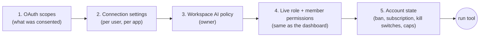

# 04 — Permissions, consent screen and the CRM settings page

How access is decided, what the user sees when connecting, how they manage
it inside Replai, and what can be managed from Claude or ChatGPT.

---

## 1. Effective permission (D7)

A tool runs only if **all five** layers allow it. Each is checked on every
call, server-side.



| Layer               | Set by               | Where                                                  | Can the AI lower it? | Can the AI raise it?                          |
| ------------------- | -------------------- | ------------------------------------------------------ | -------------------- | --------------------------------------------- |
| OAuth scopes        | User at consent      | Consent screen, re-consent                             | Yes (`disconnect`)   | Only via browser re-consent the user approves |
| Connection settings | User                 | Settings → AI Connectors, or `restrict_my_permissions` | Yes                  | No                                            |
| Workspace policy    | Owner                | Settings → AI Connectors → Workspace policy            | No                   | No                                            |
| Role / member perms | Owner                | Settings → Members (existing)                          | No                   | No                                            |
| Account state       | Billing, super admin | Existing screens                                       | No                   | No                                            |

When a call is refused, the error names the layer and the fix:

| Refused by         | Message to the model (shown to the user)                                                                               |
| ------------------ | ---------------------------------------------------------------------------------------------------------------------- |
| Scope              | Step-up: the platform asks the user to approve the extra permission in the browser                                     |
| Connection setting | "Sending messages is switched off for this Claude connection. Turn it on in Replai → Settings → AI Connectors: <link>" |
| Workspace policy   | "Your workspace owner has switched off broadcasts for AI apps."                                                        |
| Member permission  | "Your Replai role doesn't include Pipelines. Ask the workspace owner for access."                                      |
| Account state      | "This workspace needs an active subscription to continue." / "This workspace has been suspended."                      |
| Cap                | "The daily limit of 100 AI-sent messages for this connection has been reached. It resets at 00:00 (Asia/Kolkata)."     |

---

## 2. Defaults

Chosen so a new connection is useful immediately but can't do anything
high-impact without someone deciding to allow it.

### 2.1 Workspace policy (absent row = these)

| Setting                                       | Default                                          |
| --------------------------------------------- | ------------------------------------------------ |
| AI connectors enabled                         | On                                               |
| Allowed apps                                  | Claude, ChatGPT                                  |
| Members can connect                           | On                                               |
| Highest access a member connection can have   | Edit records (no sending)                        |
| Allow sending messages                        | On (owners), off for members unless raised above |
| Allow broadcasts                              | **Off**                                          |
| Allow turning automations on/off              | **Off**                                          |
| Daily AI-sent messages (workspace)            | 300                                              |
| Daily broadcast recipients via AI (workspace) | 500                                              |
| Require a preview before every send           | Off                                              |

### 2.2 Connection settings (per user, per app)

| Setting                            | Default                                        |
| ---------------------------------- | ---------------------------------------------- |
| View data                          | On (always on while connected)                 |
| Edit records                       | On                                             |
| Send messages                      | On if granted at consent and allowed by policy |
| Send to numbers not in contacts    | Off                                            |
| Broadcasts                         | Off                                            |
| Automations on/off                 | Off                                            |
| Read-only mode (master)            | Off — when on, every write is refused          |
| Daily messages for this connection | 100                                            |
| Auto-disconnect after inactivity   | 30 days                                        |

Stored in `ai_connections.settings` as:

```json
{
  "read_only": false,
  "groups": {
    "edit_records": true,
    "send_messages": true,
    "send_to_new_numbers": false,
    "broadcasts": false,
    "automations": false
  },
  "caps": { "messages_per_day": 100 },
  "idle_days": 30
}
```

Each tool maps to one group in code (`TOOL_GROUP` constant), so adding a
tool forces a decision about which switch controls it.

---

## 3. Consent screen

Route `/oauth/consent?request_id=…`, styled like the existing auth pages
(`(auth)/layout.tsx`) and similar to the Supabase example screenshot: two
logos with an arrow, a short heading, the account, the permissions, two
buttons.

```
┌──────────────────────────────────────────────────────┐
│              [Replai]  ⇄  [Claude]                   │
│                                                      │
│        Claude wants to access your Replai            │
│        Requested by claude.ai · returns to claude.ai │
│                                                      │
│  ┌──────────────────────────────────────────────┐    │
│  │ (S) Souaib Ansari · souaib@junkiescoder.com  │    │
│  │     Workspace: Junkies Coder        Not you? │    │
│  └──────────────────────────────────────────────┘    │
│                                                      │
│  Claude will be able to                              │
│   ✔ View contacts, inbox, deals and reports  (fixed) │
│   [✔] Create and edit contacts, deals, notes         │
│   [✔] Send WhatsApp messages as you                  │
│   [ ] Send broadcasts      (off in workspace policy) │
│   [ ] Turn automations on or off                     │
│                                                      │
│  Claude can only do what your Replai role allows.    │
│  You can change or remove access any time in         │
│  Settings → AI Connectors.                           │
│                                                      │
│  Data Claude reads is processed under Anthropic's    │
│  terms. Replai privacy policy                        │
│                                                      │
│        [ Cancel ]            [ Allow access ]        │
└──────────────────────────────────────────────────────┘
```

Rules:

- Only permissions that were **requested** are shown. Step-up requests
  show the new ones highlighted ("Claude is asking for one more
  permission").
- Options blocked by the workspace policy or the user's role are shown
  disabled with the reason, so nobody wonders why they can't tick them.
- The heading uses the registry name for trusted clients (Claude, ChatGPT,
  Claude Code, Codex). For any other client in development: "**An app at
  inspector.example** wants…" with a yellow warning.
- Cancel → redirect back with `error=access_denied`, `state`, `iss`.
- If the same client is already connected for this user with the same or
  wider scopes, the screen still appears (no silent re-approval in v1),
  and says "This will replace your existing Claude connection".
- Accessible: real `<button>`s and checkboxes with labels, focus on the
  primary heading on load, works with keyboard only, sufficient contrast in
  light and dark themes.
- Translations: add strings to `messages/en.json` and `messages/ko.json`
  under `AiConsent`.

---

## 4. Settings → AI Connectors

A new tab in `/settings`, visible to everyone with Settings access
(member permission `settings_ai_connectors`, absent = allow, like
`settings_live_chat`). Members see and manage **their own** connections.
Owners also see the workspace policy and everyone's connections.

```
Settings › AI Connectors

Use Replai from Claude or ChatGPT. Ask questions about your inbox,
update contacts and deals, and send messages by chatting.

┌─────────────────────────────┐  ┌─────────────────────────────┐
│ [Claude logo] Claude        │  │ [ChatGPT logo] ChatGPT      │
│ ● Connected                 │  │ ○ Not connected             │
│ Since 12 Oct · used 2 h ago │  │                             │
│ Claude web                  │  │ How to connect  ›           │
│ View · Edit · Send          │  │                             │
│ [Manage]  [Disconnect]      │  │ [Connect ChatGPT]           │
└─────────────────────────────┘  └─────────────────────────────┘
  + Claude Code connected (1)       (shown only if present)

Activity                                       [All apps ▾] [Export]
───────────────────────────────────────────────────────────────────
 Today 14:02  Claude   send_template_message  order_update → Ravi K.   ✔
 Today 14:01  Claude   search_contacts        "Ravi"                    ✔
 Today 13:40  Claude   send_broadcast         —                         ✖ Broadcasts are off
 …

Workspace policy (owners only)
───────────────────────────────────────────────────────────────────
 [✔] Allow AI connectors in this workspace
 Apps:  [✔] Claude   [✔] ChatGPT
 [✔] Members can connect     Highest member access: [Edit records ▾]
 [✔] Sending messages   [ ] Broadcasts   [ ] Automations on/off
 Daily limits: messages [300]  broadcast recipients [500]
 [ ] Require a preview before every message

Team connections (owners only)
───────────────────────────────────────────────────────────────────
 Priya (member)   ChatGPT   View · Edit   used yesterday   [Disconnect]
```

### 4.1 "Connect" buttons

There is no way for Replai to push a connection into Claude or ChatGPT; the
user starts it in the AI app. The button opens a short guide panel:

- **Before directory listing (development / beta):** step-by-step for adding
  a custom connector with the MCP URL, with a copy button for
  `https://<origin>/mcp` (see 06).
- **After listing:** a deep link to the directory listing (Claude:
  `claude.ai` connector page; ChatGPT: plugin directory URL from the
  submission portal), plus the fallback steps.

**Built (24 Oct 2026):** ChatGPT is published, so on production
**Connect ChatGPT** opens
`https://chatgpt.com/plugins/plugin_asdk_app_6ac8dee28e288191b785a43de4cac406`
in a new tab and the dialog only says "click Connect, sign in, Allow" while
it polls. Listings live in `DIRECTORY_LISTINGS`
(`src/components/settings/ai-connectors/shared.ts`) together with the MCP
URL each one was reviewed with; `directoryListingUrl` returns the link only
when this deployment serves that URL, so devcrm and local keep the manual
guide (the published plugin would connect them to production). Claude
keeps the custom-connector guide until its listing is approved.

As soon as the OAuth flow completes, the card flips to Connected (poll
every 5 s while the guide panel is open, or a realtime subscription on
`ai_connections` for the user's own rows).

### 4.2 Manage panel

Per connection: label, the group toggles and caps from §2.2 (each limited
by the policy and the granted scopes; toggles for ungranted scopes say
"Ask Claude to do it once and approve the request"), read-only master
switch, last 50 activity rows, "Disconnect".

### 4.3 APIs behind the page

| Route                                  | Who                               | Does                                                      |
| -------------------------------------- | --------------------------------- | --------------------------------------------------------- |
| `GET /api/ai-connectors`               | any member                        | My connections (owner: plus team, flagged)                |
| `PATCH /api/ai-connectors/[id]`        | connection owner, workspace owner | Update label/settings. Server clamps to policy and scopes |
| `DELETE /api/ai-connectors/[id]`       | connection owner, workspace owner | Revoke                                                    |
| `GET /api/ai-connectors/[id]/activity` | connection owner, workspace owner | Paged audit rows                                          |
| `GET/PUT /api/ai-connectors/policy`    | owner                             | Workspace policy                                          |

All use `getCurrentAccount()` (cookie session), are covered by the
existing subscription gate in `proxy.ts`, and write audit rows with
`actor = user`.

### 4.4 Other places in the CRM

- **Inbox:** "via Claude" / "via ChatGPT" badge on AI-sent messages
  (from `messages.metadata.via_ai`).
- **Contact timeline / deal history:** AI changes show the user plus the
  app.
- **Notifications:** new connection, connection removed due to suspicious
  refresh reuse, cap reached (once per day).
- **Dashboard:** nothing new in v1.
- **Super admin → account detail:** number of active AI connections per
  platform, last used, "Disable AI connectors for this workspace" switch.
  Super admin → System health: tool calls per day, error rate, p95 latency.

---

## 5. Managing from Claude or ChatGPT

What the platforms offer natively, plus what our tools add.

| Need                      | In Claude                                                                     | In ChatGPT                                                                             | Through Replai tools                                         |
| ------------------------- | ----------------------------------------------------------------------------- | -------------------------------------------------------------------------------------- | ------------------------------------------------------------ |
| See what it can do        | Connector page lists tools                                                    | App details page lists tools                                                           | `get_my_permissions`                                         |
| Turn individual tools off | Per-tool toggle in connector settings                                         | Per-tool toggle in app settings                                                        | `restrict_my_permissions` (by group)                         |
| Approve every action      | Per-tool "needs approval" vs "always allow" (destructive tools always prompt) | Write actions ask for confirmation by default; "remember for this conversation" option | `require_preview` cannot be raised by AI, only set in Replai |
| Lower access              | Toggle tools off                                                              | Toggle tools off                                                                       | `restrict_my_permissions`                                    |
| Raise access              | Re-authorise when asked (step-up)                                             | Re-link when asked                                                                     | Never by tool (D8); links to Settings                        |
| Disconnect                | Remove connector                                                              | Disconnect app                                                                         | `disconnect`                                                 |
| Several accounts          | One connection per connector                                                  | Multi-account: connect another Replai login; `get_profile` labels them                 | —                                                            |
| Both apps at once         | Independent — Claude and ChatGPT are separate connections in Replai           | ←                                                                                      | —                                                            |

Example: user says to Claude "only let yourself read from now on" →
Claude calls `restrict_my_permissions({ read_only: true })` → the user
approves the call → Replai's Settings page shows "Read-only" on the Claude
card. "Let yourself send broadcasts" → Claude explains it can't raise its
own access and gives the Settings link.

---

## 6. Changes to existing permission code

- `src/types/index.ts`: add `settings_ai_connectors?: boolean` to
  `MemberPermissions`, `DEFAULT_MEMBER_PERMISSIONS` (`true`) and
  `SETTINGS_SUB_ITEMS` ("AI Connectors — Connect Claude and ChatGPT to your
  own account").
- `src/lib/auth/roles.ts`: no change to `OWNER_ONLY_SETTINGS_SECTIONS`
  (absent = allow is right: it only governs a member's own connections).
- New pure function `src/lib/ai-connector/policy.ts`:

```ts
export function evaluateToolAccess(input: {
  tool: ToolName;
  grantedScopes: readonly string[];
  connectionSettings: ConnectionSettings;
  workspacePolicy: WorkspacePolicy;
  role: AccountRole;
  memberPermissions: MemberPermissions | null;
  accountState: { banned: boolean; blocked: boolean; aiLocked: boolean };
  platform: Platform;
}):
  | { allowed: true }
  | {
      allowed: false;
      layer: DenyLayer;
      reason: string;
      fixUrl?: string;
      missingScopes?: string[];
    };
```

Pure and exhaustively unit-tested (every tool × every layer). The gate
loads inputs; `tools/list` filtering and `withPolicy` both call it, so
listing and execution can never disagree.
