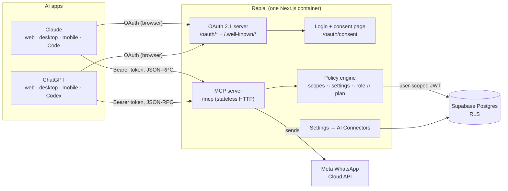

# Replai AI Connector for Claude and ChatGPT — plan

Let a Replai user connect their workspace to **Claude** and/or **ChatGPT**,
sign in through the browser, and then run the CRM by prompting: read the
inbox, find contacts, move deals, send WhatsApp messages, launch
broadcasts, switch automations on and off — everything their own Replai
role allows, nothing more.

> **Status (24 Oct 2026):** built and live on production
> (`https://wacrm.junkiescoder.com/mcp`).
>
> - **ChatGPT:** approved and **published** in the ChatGPT plugin directory:
>   https://chatgpt.com/plugins/plugin_asdk_app_6ac8dee28e288191b785a43de4cac406
>   (plugin `plugin_asdk_app_6ac8dee28e288191b785a43de4cac406`, version 1.0.0).
> - **Claude:** submitted to the Claude Connectors Directory, **still in
>   review**. Until it is listed, users add Replai in Claude as a custom
>   connector with the MCP URL.
>
> Progress and remaining items: [05-implementation-phases.md](./05-implementation-phases.md), Phase 10.

## The one-paragraph design

Replai gets a **remote MCP server** at `https://<app-origin>/mcp` and a
small, standards-only **OAuth 2.1 authorization server** inside the same
Next.js app. Claude and ChatGPT both discover it automatically, open a
browser window to Replai's login and consent page ("Claude wants to access
your Replai workspace"), and receive a revocable token. Every tool call is
re-checked live against the user's role, member permissions, the
connection's own settings, the workspace's AI policy, the subscription and
ban state, and then executed **as that user under the existing RLS
policies**. Both apps can be connected at the same time; each connection
is listed, tuned and revocable in **Settings → AI Connectors**.

## Documents

| #   | File                                                           | Read it for                                                                   |
| --- | -------------------------------------------------------------- | ----------------------------------------------------------------------------- |
| 1   | [01-architecture.md](./01-architecture.md)                     | Components, OAuth flows, token model, data model, file layout                 |
| 2   | [02-security.md](./02-security.md)                             | Threat model, every control, the security checklist each phase must pass      |
| 3   | [03-tools.md](./03-tools.md)                                   | The full tool catalog, annotations, scopes, conventions, server instructions  |
| 4   | [04-permissions-and-crm-ui.md](./04-permissions-and-crm-ui.md) | Permission model, consent screen, Settings page, managing from Claude/ChatGPT |
| 5   | [05-implementation-phases.md](./05-implementation-phases.md)   | Phase-by-phase build plan with tasks, deliverables and exit gates             |
| 6   | [06-testing-guide.md](./06-testing-guide.md)                   | Manual import into Claude and ChatGPT for development, test matrix, evals     |
| 7   | [07-deploy-and-publish.md](./07-deploy-and-publish.md)         | Production deploy, Claude Directory and ChatGPT Directory submission          |

How the built system actually works (code-verified, with a safety review): [how-it-works.md](./how-it-works.md)

## Decisions

Each one is explained where it is used. These are the defaults the rest of
the plan assumes; change one here first if you disagree.

| ID  | Decision                                                                                                                                              | Main reason                                                                                                                                                               |
| --- | ----------------------------------------------------------------------------------------------------------------------------------------------------- | ------------------------------------------------------------------------------------------------------------------------------------------------------------------------- |
| D1  | **Own minimal OAuth 2.1 server in the Next.js app** (authorization code + PKCE + refresh only)                                                        | Needs CIMD, `resource`→audience binding, RFC 9207 `iss`, custom scopes and instant revocation. Supabase's OAuth server is beta and has none of the first four documented. |
| D2  | **Same container and origin as the app.** MCP at `https://<app-origin>/mcp`, issuer `https://<app-origin>`                                            | Consent page shares the existing login cookie; no new infra on the t4g.micro                                                                                              |
| D3  | **Tools run as the user under RLS**, via a 5-minute Supabase JWT minted per connection, plus restrictive "AI-deny" RLS on sensitive tables            | Existing helpers rely on RLS for tenant isolation; RLS becomes a second wall behind the app checks                                                                        |
| D4  | **Opaque, hashed tokens** (not JWTs). Access 1 h, refresh 30 d rotating with reuse detection                                                          | Revocation is one UPDATE and takes effect on the next call                                                                                                                |
| D5  | **CIMD first, DCR as restricted fallback, trusted-client registry**; unknown clients blocked in production                                            | Both platforms prefer CIMD; DCR is deprecated in MCP 2026-07-28; the registry stops "fake Claude" phishing                                                                |
| D6  | **Stateless Streamable HTTP, JSON responses, no SSE**, `@modelcontextprotocol/sdk` pinned (1.31.x, protocol 2025-11-25)                               | Works with today's clients and is already the shape of the 2026-07-28 stateless spec                                                                                      |
| D7  | **Effective permission = OAuth scopes ∩ connection settings ∩ workspace AI policy ∩ live role/member permissions ∩ plan/ban state**                   | One rule, evaluated server-side on every call                                                                                                                             |
| D8  | **The AI can lower its own access, never raise it.** Raising happens in Replai or through a browser re-consent                                        | Prompt injection must never be able to escalate privileges                                                                                                                |
| D9  | **High-impact actions are two-step** (preview → `confirmation_id`) and capped; some things are never exposed at all                                   | Server-enforced brakes that hold even if the user clicks "always allow"                                                                                                   |
| D10 | **One server for both platforms.** Platform-specific bits are metadata only                                                                           | One codebase, one test suite                                                                                                                                              |
| D11 | **No in-chat UI widgets in v1.** MCP Apps widgets are a later phase                                                                                   | Widgets add CSP, screenshots and review time; text tools deliver the value first                                                                                          |
| D12 | **Keep the existing `mcp-server/` (stdio, API key) package** for self-hosters and scripts; the remote connector is the recommended path for end users | Different audience, no conflict                                                                                                                                           |

## Phases at a glance

| Phase | Name                                   | Outcome                                                                        | Size |
| ----- | -------------------------------------- | ------------------------------------------------------------------------------ | ---- |
| 0     | Foundations and spikes                 | Decisions confirmed, accounts and verifications started, risky unknowns proven | S    |
| 1     | Data model and core libraries          | Migrations, token store, policy engine, audit log — all unit-tested            | M    |
| 2     | OAuth 2.1 authorization server         | Browser sign-in + consent works end-to-end with MCP Inspector                  | L    |
| 3     | MCP server skeleton + first read tools | Claude and ChatGPT connect in development and can search contacts/inbox        | M    |
| 4     | CRM Settings → AI Connectors           | Status, permissions, revoke, activity log, workspace policy, alerts            | M    |
| 5     | Full read coverage                     | Every CRM area readable                                                        | M    |
| 6     | Record writes                          | Contacts, tags, notes, deals, conversation status/assignment                   | M    |
| 7     | Messaging, broadcasts, automations     | WhatsApp sends with policy checks, two-step broadcasts, on/off switches        | L    |
| 8     | Hardening and QA                       | Security checklist, isolation suite, red-team, load test, external pentest     | M    |
| 9     | Production rollout and private beta    | Live on the production origin for selected workspaces                          | S    |
| 10    | Directory submission and publishing    | Listed in the Claude Connectors Directory and the ChatGPT Directory            | M    |
| 11    | Post-launch extensions (optional)      | In-chat widgets, skills/plugins, 2026-07-28 protocol upgrade                   | —    |

S ≈ a few days, M ≈ 1–2 weeks, L ≈ 2–3 weeks for one developer. Treat
these as relative sizes, not commitments.

## Things to start now (long lead time)

These don't depend on code and some take weeks:

1. **OpenAI identity verification** for the publishing name (business
   verification for "Junkies Coder", or individual). Submission is rejected
   without it.
2. **A ChatGPT plan that has developer mode** (Plus, Pro, Business,
   Enterprise or Edu). The current ChatGPT account is on Go, which can't
   create developer-mode apps.
3. **A paid Claude plan** for whoever submits to the directory. A free
   Claude account can add one custom connector, which is enough for testing.
4. **The permanent production hostname.** The ChatGPT plugin's MCP origin
   (scheme, host, port) can't change after publishing. If a Replai-branded
   domain is coming, switch to it before Phase 10.
5. **A reviewer demo workspace** with realistic sample data and a
   password login without MFA (both directories require one).

## Top risks

| Risk                                                                      | Mitigation                                                                                                                                   |
| ------------------------------------------------------------------------- | -------------------------------------------------------------------------------------------------------------------------------------------- |
| Dev and prod share one Supabase project, so dev testing touches real data | Dev connector is limited to an allowlist of test workspaces (`AI_CONNECTOR_ALLOWED_ACCOUNTS`); tokens are bound to their issuer and resource |
| A model is tricked by text inside a customer's WhatsApp message           | Privilege raise impossible from the AI, caps, two-step high-impact actions, AI-deny RLS, destructive annotations                             |
| Mass messaging gets the WhatsApp number flagged by Meta                   | Broadcasts off by default, per-connection caps, opt-out suppression, 24-hour-window rules, kill switches                                     |
| Building an authorization server is security-critical                     | Narrow feature set, proven primitives, exhaustive tests, MCP Inspector auth debugger, external pentest before publishing                     |
| Claude's CIMD document can't be fetched from cloud IPs (known issue)      | Pinned copies of trusted CIMD documents in the client registry, DCR fallback                                                                 |
| Platform requirements change monthly                                      | Re-verify every requirement in 07 against the official docs at the start of Phase 10                                                         |

## Official references

- MCP authorization (2025-11-25): https://modelcontextprotocol.io/specification/2025-11-25/basic/authorization
- MCP 2026-07-28 changelog: https://modelcontextprotocol.io/specification/2026-07-28/changelog
- Claude — authentication for connectors: https://claude.com/docs/connectors/building/authentication
- Claude — lazy authentication and step-up: https://claude.com/docs/connectors/building/lazy-authentication
- Claude — pre-submission checklist: https://claude.com/docs/connectors/building/review-criteria
- Claude — submitting to the directory: https://claude.com/docs/connectors/building/submission
- OpenAI — plugin authentication: https://developers.openai.com/apps-sdk/build/auth/
- OpenAI — connect and test (developer mode): https://developers.openai.com/plugins/deploy/connect-chatgpt
- OpenAI — remote MCP review requirements: https://developers.openai.com/plugins/deploy/app-review
- OpenAI — plugin guidelines: https://developers.openai.com/plugins/plugin-guidelines
- Supabase — JWT signing keys (importing a key): https://supabase.com/docs/guides/auth/signing-keys
- Supabase — OAuth 2.1 server (considered, not chosen): https://supabase.com/docs/guides/auth/oauth-server

Platform requirements in this plan were paraphrased from these pages.
