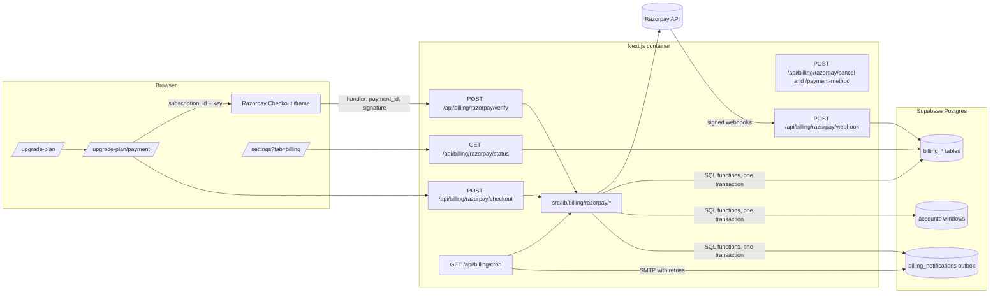
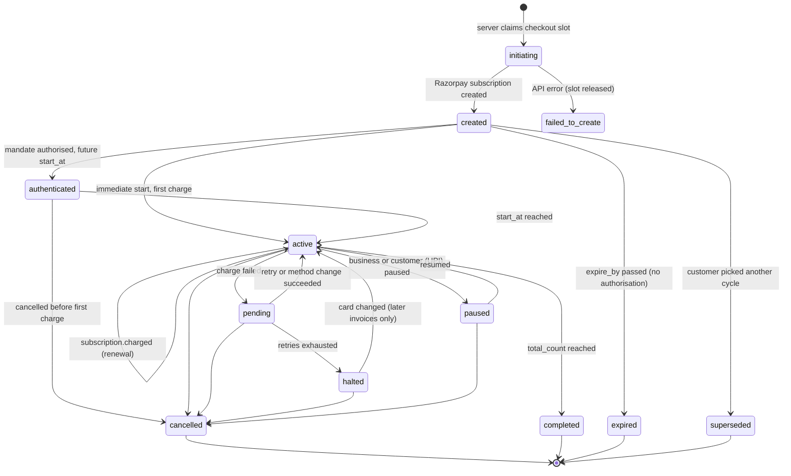

# Razorpay Subscriptions: implementation plan

Status (21-10-2026): **Phase 0 done** (one blocker, see [phase-0 report](./phase-0-razorpay-setup-report.md)), **Phase 1 done** ([phase-1 report](./phase-1-implementation-report.md)). Phases 2 to 7 not started. All decisions D1 to D12 accepted with the recommended defaults. Index of reports: [README.md](./README.md).

Written for `whatsapp-crm-nextjs` (Replai).
Scope: replace manual UPI QR + UTR + super-admin approval with Razorpay recurring subscriptions, while keeping the existing trial, plan catalogue, access gate and history.

How to use this file: work through section 15 one phase at a time. Each phase lists its dependencies, files, risks and acceptance criteria. Section 16 lists the decisions needed before Phase 1 starts.

> **Razorpay MCP is connected to Kiro** (test key, sandbox). It is used throughout this plan for read-only verification of test payments, refunds, tokens and settlements. It **cannot** create plans, subscriptions, invoices or webhooks (no such tools exist on the hosted server), so those are created through the Razorpay Dashboard or the app's own server-side REST client. See section 2.12.

---

## 1. How billing works today (source of truth: code + live DB)

### 1.1 Live configuration (read-only query, 06-08-2026)

| Item                    | Value                                                                                                                                                              |
| ----------------------- | ------------------------------------------------------------------------------------------------------------------------------------------------------------------ |
| `subscription_settings` | `is_enabled=true`, `trial_days=14`, `grace_days=0`, `currency='INR'`, `show_trial_badges=true`, UPI id set                                                         |
| Plans                   | ONE visible plan, `Replai` (`aaa689df-…`)                                                                                                                          |
| Billing cycles          | `Monthly`: `months=0`, `duration_days=30`, ₹990. `Yearly`: `months=0`, `duration_days=360`, ₹9,000, `is_default` + `is_recommended`                                |
| Accounts                | 19 total: 17 stored `trialing`, 2 stored `active`. 11 open trials, 3 open paid windows, 1 paid window queued behind a trial, 4 with `plan_selection_required=true` |
| `payment_requests`      | 2 approved, 4 rejected, **0 pending**. All INR                                                                                                                     |
| `subscription_events`   | 27 expired, 28 trial_extended, 14 activated, 9 extended, 6 submitted, 2 approved, 4 rejected                                                                       |

So the two options in the screenshots are **two billing cycles of one plan** (`Replai · Monthly` and `Replai · Yearly`), not two plans. Both are fixed-day terms (30 and 360 days), not calendar months or years.

### 1.2 Data model (migrations `050`, `051`, `052`, `055`, `056`, `057`, `081`, `20260824030000`)

- `subscription_settings` (singleton): master switch, `trial_days`, `grace_days`, UPI payee, currency and every string on `/upgrade-plan`, the payment screen, the trial badge and the member-blocked screen.
- `billing_cycles`, `subscription_plans`, `subscription_plan_prices`: the catalogue. RLS on, **no client policies**. Read only through the service role, which is what keeps price under server control.
- `accounts` subscription columns: `subscription_status` (`trialing|active|expired|none`, a hint only), `trial_started_at`, `trial_ends_at`, `subscription_plan_id/name`, `subscription_cycle_label`, `subscription_started_at`, `subscription_ends_at`, `subscription_note`, plus `selected_plan_id`, `selected_cycle_id`, `plan_selected_at`, `plan_selection_required`.
- `payment_requests`: one row per UTR submission with plan/cycle snapshots, server-computed `expected_amount`, payer-claimed `paid_amount`, payer details, review fields, granted window. Unique live UTR index and one-pending-per-account index. Members can SELECT their account's rows.
- `subscription_events`: append-only audit, service role only, with duration and `window_kind` since `081`.
- Trigger `accounts_set_trial_defaults` (BEFORE INSERT on `accounts`): stamps `trial_started_at = now()` and `trial_ends_at = now() + trial_days` for every new account, and marks pre-provisioned accounts as not needing plan selection.

### 1.3 Signup to trial to plan choice

1. Signup creates the account. The trigger **starts the trial clock at signup**, not when the user clicks anything.
2. New accounts have `plan_selection_required = true`. `src/proxy.ts` sends an owner to `/upgrade-plan` (members go to `/dashboard`) before any CRM page.
3. `/upgrade-plan` (`src/app/upgrade-plan/page.tsx`) loads `GET /api/billing/plans` and `GET /api/billing/subscription` (through `useSubscription`). It renders one card per visible priced cycle. The headline is the per-day rate, with the true total underneath.
4. `showTrialOffer` is true when `show_trial_badges` is on, `trial_days > 0`, the account is not blocked, billing is enabled and there is no paid coverage. Both buttons call `POST /api/billing/select-plan`, which validates the pair server-side, stores `selected_plan_id/cycle_id` and clears `plan_selection_required`.
   - **Start with trial** only saves the choice and goes to `/dashboard`. It does not start or extend anything, because the trial is already running.
   - **Continue to Payment** saves the choice and goes to `/upgrade-plan/payment?plan=…&cycle=…`.

### 1.4 Manual payment (`/upgrade-plan/payment`)

1. `GET /api/billing/upi-qr` (owner only, 60/min) resolves the price with `resolveQuote`, builds a `upi://pay` URI and an SVG QR, and returns a `wouldEndAt` preview.
   - Finding: `wouldEndAt` is computed **from now** (`previewQuoteWindow`), but approval queues the window behind an open trial. The screenshot shows this: the trial runs to 27 Nov 2026 while the payment page says "valid until 14 Oct 2027". The real end date after approval would be 360 days after 27 Nov 2026.
2. "I have paid" opens `PaymentSubmissionForm`, which calls `POST /api/billing/payment-requests` (owner, 5/min, validated, one pending per account, UTR uniqueness, server price). It writes a `payment_submitted` event, sends an acknowledgement email in `after()`, and the DB trigger `sa_notify_payment_request` raises a super-admin notification.
3. The page polls `/api/billing/subscription` every 10 s until a verdict arrives.

### 1.5 Review and activation

- `/super-admin/payments` → Payment requests tab → `PATCH /api/super-admin/billing/payment-requests`.
- **Approve** (`approvePaymentRequest` in `src/lib/subscription/activate.ts`): claims the row with a conditional `UPDATE … WHERE status='pending'` before granting (claim-before-grant), then `activateSubscription` applies **window stacking**:
  - open trial → paid window starts at `trial_ends_at` (status stays `trialing`)
  - open paid window → extends from `subscription_ends_at`
  - otherwise → starts now
  - optional duration override. Sends an approved email.
- **Reject** requires a customer-visible note, releases the UTR and sends a rejected email.
- The Subscribers tab (`src/app/api/super-admin/billing/subscriptions/route.ts`) has manual operator actions: `grant`, `set_end_date`, `extend_trial`, `set_trial_end_date`, `expire_now`, `expire_trial`, `expire_paid`, `expire_both`, `revoke`, `set_status`.

### 1.6 Access gate

- `resolveSubscriptionState` (`src/lib/subscription/status.ts`) is pure and shared by proxy, API guards and UI. Dates decide, the stored status only says which window is primary.
  - `expired` forces a block.
  - `none` is never gated.
  - `grace_days` (currently 0) extends access past the end date.
  - Queued windows are exposed as `pendingWindow`.
- `src/proxy.ts` reads `is_banned, subscription_status, trial_ends_at, subscription_ends_at, plan_selection_required` in the same query as the ban check.
  - Blocked owner → `/upgrade-plan`. Blocked member → `/subscription-required`.
  - Gated APIs answer 403 `subscription_required`.
  - `/api/billing/*` is in `UNGATED_API_PREFIXES`, so a lapsed account can always pay.
- `src/lib/subscription/guard.ts`: `requireBillingOwner`, `requireActiveSubscription`, `getBillingContext`.

### 1.7 Customer billing page (`/settings?tab=billing`)

- `src/components/settings/billing-settings.tsx`:
  - the "Current" window plus an "Up next" queued window
  - the access-until date
  - a pending-review card
  - the last rejection reason
  - an unpaid "Upcoming plan" card with a Pay now link
- `src/components/settings/billing-history.tsx` shows two lists through `GET /api/billing/history`: payments (from `payment_requests`) and plan activity (from `subscription_events`, payment-linked rows excluded). Paging is server-side.

### 1.8 Emails and jobs

- `src/lib/email/billing.ts`: submitted, approved and rejected emails. `src/lib/email/send.ts` uses nodemailer over SMTP, **never throws**, has **no retry and no delivery log**.
- `src/lib/auto-mail/reminders.ts` + `GET /api/auto-mail/cron`: trial and paid expiry reminders.
  - Idempotent through a unique claim index on `auto_email_log`.
  - Skips accounts with a queued window.
- `deploy/cron-ping.sh` hits a **hardcoded** endpoint list every 5 minutes. CI does not deploy it.

### 1.9 Findings that shape the migration

| #   | Finding                                                                                            | Consequence                                                                                                                                                              |
| --- | -------------------------------------------------------------------------------------------------- | ------------------------------------------------------------------------------------------------------------------------------------------------------------------------ |
| F1  | The trial starts at signup (DB trigger), not on "Start with trial".                                | Already satisfies "a new checkout must not restart the trial", as long as new code never writes `trial_ends_at`. Changing to start-on-click is a separate decision (D7). |
| F2  | Durations are fixed days (30 / 360), stored as `duration_days` with `months=0`.                    | Razorpay must be configured as `period=daily` with `interval=30` and `interval=360` to keep them. Section 2.6.                                                           |
| F3  | Window stacking already exists and is the right model for "pay during trial".                      | The Razorpay first charge is scheduled at the end of the current coverage, and paid time is added with `greatest()`.                                                     |
| F4  | `sendEmail` has no retry or delivery status.                                                       | A notification outbox is needed for payment emails (section 10).                                                                                                         |
| F5  | Auto-mail "paid" reminders tell people their access is ending.                                     | Wrong for autopay customers. They must be skipped or reworded (Phase 4).                                                                                                 |
| F6  | Super-admin manual actions write `subscription_ends_at` directly.                                  | With autopay, a manual grant does not move Razorpay's charge date. The UI must warn (Phase 5).                                                                           |
| F7  | Account delete (`sa_delete_account`) and ban know nothing about external mandates.                 | A deleted or banned workspace could keep being charged. Delete and ban must cancel autopay first (Phase 5).                                                              |
| F8  | Dev and prod share one Supabase database.                                                          | Test-mode payments on dev could change real `accounts` rows. Needs a mode column, an account allowlist in test mode, and per-environment webhook secrets (section 5).    |
| F9  | The CSP (Report-Only) has no Razorpay hosts, and `Permissions-Policy` sets `payment=()`.           | `next.config.ts` must allow Checkout before CSP is ever enforced, and the `payment` policy must be checked in a real browser (Phase 2).                                  |
| F10 | CI writes `/opt/wacrm/.env` from the `PROD_ENV` GitHub secret on every deploy (`master_ci.yml`).   | Razorpay env vars must be added to `PROD_ENV`, not edited on the server. Note that AGENTS.md §7 says CI does not touch `.env`, which the workflow contradicts.           |
| F11 | `legal_pages` has Terms, Privacy, Cookie, AUP and DPA. There is no Refund and Cancellation policy. | Razorpay activation reviews website policies, and autopay terms need a home. This is a prerequisite (section 12).                                                        |
| F12 | The rate limiter is in-memory per process.                                                         | Acceptable on the single container. Correctness (no double charge, no double grant) must come from DB constraints, never from the limiter.                               |

---

## 2. Razorpay capabilities (from current official docs)

Content below is paraphrased from Razorpay's documentation. Sources are linked at the end of this section. Anything not confirmed in the docs is marked **(verify in Phase 0)**.

### 2.1 Objects

| Object          | What it is                                                                        | Notes                                                                                                                                                               |
| --------------- | --------------------------------------------------------------------------------- | ------------------------------------------------------------------------------------------------------------------------------------------------------------------- |
| Plan            | Reusable price + frequency template (`period`, `interval`, item amount, currency) | Amount is fixed per plan, so a price change needs a new plan.                                                                                                       |
| Subscription    | One customer on one plan: `start_at`, `total_count`, `expire_by`, `notes`, status | Created by our server, then authorised by the customer in Checkout.                                                                                                 |
| Customer        | Created automatically by Razorpay on the authorisation payment                    | We store only the `cust_` id.                                                                                                                                       |
| Invoice         | Generated at the start of each billing cycle and charged automatically            | Has `billing_start`/`billing_end`, amounts, tax fields, `short_url` and `payment_id`.                                                                               |
| Payment         | Each auth or charge attempt                                                       | Status `created/authorized/captured/refunded/failed`, method, card summary, `fee` (incl. GST) and `tax`, `error_*` fields. Subscription payments are auto-captured. |
| Mandate / token | The recurring instruction (card SI, UPI AutoPay mandate, eMandate)                | Managed by Razorpay. Customers can manage UPI mandates in their UPI app and card SI in their bank's portal.                                                         |

### 2.2 Authorisation versus collection

The first payment on a subscription is the **authentication transaction**. What it charges depends on start date and upfront amount:

| `start_at`          | Upfront amount | What the customer pays during Checkout          | Invoice for it |
| ------------------- | -------------- | ----------------------------------------------- | -------------- |
| Immediate (omitted) | none           | The plan amount (this is the first real charge) | Yes            |
| Future              | none           | **₹5 token, auto-refunded**                     | No             |
| Immediate           | yes            | Upfront + plan amount                           | Yes            |
| Future              | yes            | Upfront amount                                  | Yes            |

So:

- "Continue to pay" during a trial = **future `start_at` = authorise only**. The customer sees a ₹5 verification charge that Razorpay refunds, and the first real charge happens at `start_at`. Whether UPI uses the same ₹5 token or a different amount is **(verify in Phase 0)**.
- "Continue to pay" after the trial = **immediate start = pay now**.
- A successful mandate is `subscription.authenticated`. A collected payment is `subscription.charged`. They are different events and must never be shown to the customer as the same thing.

### 2.3 Payment methods and limits

| Method                                       | Status for Subscriptions                                                                                                                                                               | Limits that matter here                                                                                                                      | Customer control                                                                                                                                                       |
| -------------------------------------------- | -------------------------------------------------------------------------------------------------------------------------------------------------------------------------------------- | -------------------------------------------------------------------------------------------------------------------------------------------- | ---------------------------------------------------------------------------------------------------------------------------------------------------------------------- |
| Cards (credit, some debit, prepaid)          | Supported. Visa, Mastercard and RuPay (Amex credit also listed in the FAQ). Not every bank's debit card supports recurring; Checkout shows "Card does not support recurring payments". | Domestic: debits up to ₹15,000 run without customer action. Above that, every debit needs AFA. Both ₹990 and ₹9,000 are below the threshold. | Pause/resume/cancel through the issuer's portal.                                                                                                                       |
| UPI AutoPay                                  | Supported, INR only. FAQ labels it **early access**.                                                                                                                                   | Shown in Checkout only when the amount is under ₹15,000. Debits complete by 9 PM IST on the due date, and retries can push this to T+1.      | Customers can pause, resume and cancel in their UPI app. **UPI subscriptions cannot be updated** (no plan change, no extra charge) and **cannot be charged manually**. |
| eMandate (netbanking / debit card / Aadhaar) | Supported, INR only. FAQ labels it **limited access**.                                                                                                                                 | Registration and first debit cannot happen on the same day, so activation can take T+1 and updates 1 to 2 days.                              | Customer cancels through their bank.                                                                                                                                   |

The settings page says methods are toggled in Dashboard → Subscriptions → Settings, while the FAQ says enabling a method needs support. Treat method availability as **account-specific** and confirm on the actual account.

**Recommendation:** launch with **Cards + UPI AutoPay** and **eMandate off**. eMandate's T+1 activation breaks "pay now and get in immediately" after an expired trial.

### 2.4 PhonePe and other UPI apps

The FAQ lists AutoPay-capable handles. For mandates up to ₹15,000 these include PhonePe (`@ybl`, `@ibl`, `@axl`), Google Pay (`@okhdfcbank`, `@okicici`, `@okaxis`), Paytm (`@paytm`), BHIM (`@upi`), Amazon Pay (`@apl`, `@yapl`) and others. QR is supported on Standard Checkout. Intent support varies by app and platform; for example, on mobile web Standard Checkout lists PhonePe and Paytm intent but not GPay or BHIM. So PhonePe can be used for the recurring flow at our price points. The exact Checkout presentation on desktop and mobile is **(verify in Phase 0)**.

### 2.5 Domestic versus international, currency

- UPI and eMandate: INR only.
- Cards: the FAQ says card subscriptions can be accepted in Razorpay's supported international currencies.
- International card acceptance must be **approved and enabled** on the account (Dashboard → Account & Settings → International payments), after banking-partner checks.
- RBI e-mandate rules (pre-debit notice, ₹15,000 AFA threshold) apply to domestic cards, not international ones.
- Our catalogue has one currency (`subscription_settings.currency = 'INR'`).

**Recommendation:** v1 is **INR only**. International customers can pay INR with an international card only if Razorpay enables international payments on the account. Multi-currency pricing is out of scope.

### 2.6 Billing intervals versus our 30 / 360 days (mismatch check)

- Razorpay plan `period` ∈ `daily | weekly | monthly | quarterly | yearly`. For daily plans the `interval` must be at least 7.
- `monthly` and `yearly` periods are calendar based, so 28 to 31 days and 365 or 366 days.
- To **preserve the existing durations** we must use:
  - Monthly → `period=daily, interval=30`
  - Yearly → `period=daily, interval=360`
- **Unverified:**
  - whether `interval=360` is accepted for a daily plan
  - whether UPI AutoPay and card SI accept these custom frequencies. The create-subscription doc says future-start subscriptions use frequency `as_presented`, which suggests yes.
  - These are **(verify in Phase 0, blocking)**.
- **If Razorpay rejects them**, we do not silently switch to calendar months. You choose (D1): calendar `monthly`/`yearly` with updated copy and per-day maths, or another option.
- `total_count` is required. The FAQ says up to 100 years, while the integration guide's error table says subscriptions can currently be charged for up to 10 years. We use the conservative bound: roughly 10 years minus the deferral, so about 120 cycles for 30-day and 10 for 360-day. The exact maximum is **(verify in Phase 0)**.

### 2.7 Deferred start, retries, cancel, update, pause, method change

| Topic                                 | Behaviour                                                                                                                                                                                                                                                                                                          |
| ------------------------------------- | ------------------------------------------------------------------------------------------------------------------------------------------------------------------------------------------------------------------------------------------------------------------------------------------------------------------ |
| Deferred start                        | `start_at` in the future creates a free trial period. The customer authorises now and the billing cycle starts at `start_at`. Behaviour when `start_at` is very close (under 36 hours, given pre-debit timing) is **(verify in Phase 0)**.                                                                         |
| Authorisation window                  | `expire_by` bounds how long a `created` subscription can be authorised (default 30 years). We set 24 hours.                                                                                                                                                                                                        |
| Retries (cards and UPI)               | Charge at T. On failure the subscription moves to `pending` and is retried on T+1, T+2 and T+3. Then it becomes `halted`. eMandate retries only after the bank confirms the previous attempt.                                                                                                                      |
| Pending → recovered                   | If the customer changes the card while `pending`, Razorpay charges the last invoice automatically.                                                                                                                                                                                                                 |
| Halted → recovered                    | Changing the card moves the subscription back to `active`, but invoices issued in the meantime are **not** charged automatically and must be charged manually. Only subsequent invoices are charged. **Recommendation:** recover a halted subscription by cancelling it and starting a fresh one that charges now. |
| Change payment method                 | Checkout option `subscription_card_change: 1` lets the customer change the card. The hosted page in Razorpay's failure email can switch a card to card/UPI/eMandate, but UPI or eMandate can only move to card.                                                                                                    |
| Cancel                                | Immediately or `cancel_at_cycle_end=true`. A cancelled subscription can never be reactivated.                                                                                                                                                                                                                      |
| Update (plan, quantity, start, count) | Only in `authenticated` or `active`, immediately (pro-rated charge or refund) or at cycle end. **Not possible for UPI.**                                                                                                                                                                                           |
| Pause / resume                        | Only `active` subscriptions can be paused. Business can pause all methods. Customers can pause UPI from their app, and only the customer can resume a customer-paused UPI mandate.                                                                                                                                 |
| Completed                             | All `total_count` invoices generated → `completed`. A new subscription is needed to continue.                                                                                                                                                                                                                      |

### 2.8 Consent and pre-debit notices

- The first transaction goes through 2FA (OTP / 3-D Secure for cards, UPI PIN for UPI). Card details are tokenised with explicit customer consent inside Razorpay Checkout.
- For domestic cards, Razorpay starts the debit about 36 hours ahead and the bank sends a pre-debit SMS. The customer can pause or cancel before the debit. This satisfies the RBI 24-hour notice.
- UPI apps show the mandate and pre-debit notices in the app.
- With `customer_notify=true` (default), Razorpay emails/SMSes the customer at 8 lifecycle stages: created, initialised, charged, completed, charge failed with an update-card link, card updated, halted, cancelled.
- Our own consent: Checkout shows Razorpay's mandate screen. We additionally require an explicit consent checkbox and show the exact amount, cadence, first charge date and cancel terms **before** opening Checkout (section 8). Starting a trial never touches Razorpay, so it can never imply consent.

### 2.9 Webhooks

- **Subscription events:** `subscription.authenticated`, `activated`, `charged`, `pending`, `halted`, `cancelled`, `completed`, `updated`, `paused`, `resumed`.
- **Also used:**
  - `payment.authorized`, `payment.captured`, `payment.failed`
  - `invoice.paid`, `invoice.partially_paid`, `invoice.expired`
  - `refund.created`, `refund.processed`, `refund.failed`
  - `payment.dispute.created`, `won`, `lost`, `closed`, `under_review`, `action_required`
  - `payment.downtime.started`, `resolved`, `updated` (optional, for UI messaging)
- **Signature:** `X-Razorpay-Signature` = HMAC-SHA256(raw body, webhook secret). After a secret rotation, retries of older events are signed with the old secret, so validate against both during rotation.
- **Delivery:** at-least-once. `x-razorpay-event-id` is unique per event and stays the same across retries and replays. Order is **not** guaranteed.
- **Timeout and retries:** a response slower than 5 seconds counts as a failure. Non-2xx responses are retried with exponential backoff for 24 hours, after which the webhook is **disabled** and an alert email is sent.
- **Replay:** from Dashboard → Developers → Webhooks, events up to 7 days old, at most 5 replays per 24 hours, only unacknowledged events.
- **Test URLs:** localhost cannot receive events. `ngrok.io`, `loca.lt`, `webhook.site`, `requestbin.com` and similar are blocked. `devcrm.junkiescoder.com` (our Cloudflare tunnel) is fine.

### 2.10 Test Mode versus Live Mode

|               | Test Mode                                                                                                                                                     | Live Mode                                        |
| ------------- | ------------------------------------------------------------------------------------------------------------------------------------------------------------- | ------------------------------------------------ |
| Keys          | `rzp_test_…` (have)                                                                                                                                           | `rzp_live_…` only after account activation (KYC) |
| Webhooks      | Configured separately, separate secret                                                                                                                        | Configured separately, separate secret           |
| Renewals      | Dashboard "Charge this now" simulates the next charge. **Card tokens last only 3 days in test mode**, so renewal tests must run within 3 days of authorising. | Real schedule                                    |
| Cards         | Test cards: Visa credit `4718 6091 0820 4366`, Mastercard debit `5104 0600 0000 0008`, international Mastercard `5104 0155 5555 5558`, any CVV, future expiry | Real cards                                       |
| Payload shape | Same as live, so test webhook handling transfers                                                                                                              | Same                                             |

### 2.11 Account-specific prerequisites (not confirmed yet)

These depend on your Razorpay account and need answers from the Dashboard or Razorpay support:

1. Account activation (KYC) status, business type and MCC. Live keys are unavailable until activation.
2. Subscriptions enabled in Live Mode.
3. **UPI AutoPay for Subscriptions** enabled ("early access").
4. Flash Checkout enabled. Without it, Checkout fails with "Oops! Something went wrong" for subscriptions.
5. International card payments approved (only if you want them).
6. Pricing and fees for card and UPI recurring. The pricing plan can block UPI recurring below a minimum amount ("Payment failed. Please contact the site admin").
7. Website compliance: refund and cancellation policy, contact details and pricing visible on the site.
8. GST: whether ₹990 / ₹9,000 are GST-inclusive, and whether Razorpay subscription invoices are enough as tax invoices (D10).

### 2.12 Razorpay MCP in Kiro: what it can and cannot do

Connected server: Razorpay's hosted MCP (`https://mcp.razorpay.com/mcp`) with the **test** key. Verified working on 06-08-2026: `fetch_all_payments` and `fetch_all_orders` both returned empty collections.

| Use in this project                                                                   | MCP tools                                                                                            |
| ------------------------------------------------------------------------------------- | ---------------------------------------------------------------------------------------------------- |
| Verify a test checkout produced the expected payment, amount, method and card summary | `fetch_all_payments`, `fetch_payment`, `fetch_payment_card_details`                                  |
| Verify the subscription invoice's order and payments                                  | `fetch_order`, `fetch_order_payments`, `fetch_all_orders`                                            |
| Verify refunds after a test refund made in the Dashboard                              | `fetch_all_refunds`, `fetch_refund`, `fetch_multiple_refunds_for_payment`                            |
| Simulate a revoked card mandate (test)                                                | `fetch_tokens`, `revoke_token`                                                                       |
| Settlement and fee reconciliation checks                                              | `fetch_all_settlements`, `fetch_settlement_with_id`, `fetch_settlement_recon_details`                |
| Reference Checkout snippets                                                           | `detect_stack`, `integrate_razorpay_checkout` (reference only; our implementation follows section 7) |

**Not available through MCP:** creating or fetching plans, subscriptions and invoices; cancelling subscriptions; webhook configuration; Subscriptions settings; KYC; creating refunds. Those go through the Razorpay Dashboard or the app's server-side REST client (`src/lib/billing/razorpay/client.ts`, Phase 1). Phase 0 spikes use a throwaway script in `scratch/` with the test key, and they send that key only to `api.razorpay.com`.

Safety rules for MCP use:

- Test key only. **Never connect the live key to the MCP server.**
- MCP calls are read-only verification, apart from `revoke_token` in test mode.
- The test key secret was pasted in chat and is stored in plain text in `~/.kiro/settings/mcp.json`. Regenerate it before Phase 2 and update both the app env and the MCP config.

### 2.13 Sources

- [How Subscriptions work](https://razorpay.com/docs/payments/subscriptions/workflow/)
- [Create Subscriptions (trial and upfront)](https://razorpay.com/docs/payments/subscriptions/create/)
- [Create a Plan API](https://razorpay.com/docs/api/payments/subscriptions/create-plan/)
- [Create a Subscription API](https://razorpay.com/docs/api/payments/subscriptions/create-subscription)
- [Subscription entity](https://razorpay.com/docs/api/payments/subscriptions/entity/)
- [Cancel a Subscription API](https://razorpay.com/docs/api/payments/subscriptions/cancel-subscription/)
- [Update a Subscription](https://razorpay.com/docs/payments/subscriptions/update/)
- [Fetch invoices of a Subscription](https://razorpay.com/docs/api/payments/subscriptions/fetch-invoices/)
- [Supported payment methods](https://razorpay.com/docs/payments/subscriptions/supported-payment-methods/)
- [Subscriptions settings](https://razorpay.com/docs/payments/subscriptions/settings/)
- [Subscriptions FAQs](https://razorpay.com/docs/payments/subscriptions/faqs/)
- [Payment retries](https://razorpay.com/docs/payments/subscriptions/payment-retries/)
- [Notifications](https://razorpay.com/docs/payments/subscriptions/notifications/)
- [Integration guide (signature verification)](https://razorpay.com/docs/payments/subscriptions/integration-guide/)
- [Test Subscriptions](https://razorpay.com/docs/payments/subscriptions/test/)
- [Pause, resume, cancel](https://razorpay.com/docs/payments/subscriptions/pause-resume-cancel/)
- [Subscription webhooks](https://razorpay.com/docs/payments/subscriptions/subscribe-to-webhooks/)
- [All webhook events](https://razorpay.com/docs/webhooks/all)
- [Validate and test webhooks](https://razorpay.com/docs/webhooks/validate-test)
- [Webhook best practices](https://razorpay.com/docs/webhooks/best-practices)
- [Replay webhook events](https://razorpay.com/docs/webhooks/replay-events)
- [Payment entity](https://razorpay.com/docs/api/payments/entity/)
- [International cards](https://razorpay.com/docs/payments/international-payments/international-debit-credit-cards/)
- [Business website details](https://razorpay.com/docs/payments/dashboard/account-settings/business-website-details/)
- [Razorpay remote MCP](https://razorpay.com/docs/mcp-server/remote/)
- [razorpay-mcp-server tools list](https://github.com/razorpay/razorpay-mcp-server/blob/main/README.md)

---

## 3. Target design

### 3.1 Principles

1. **The server owns money facts.** These all come from the DB and the Razorpay API, never from the browser:
   - plan, cycle, amount, currency
   - `start_at` and trial eligibility
   - account ownership and the subscription id
2. **Only verified provider state grants access.** That means either a signature-verified webhook, or a server-to-server fetch from `api.razorpay.com` with our key, that shows:
   - a captured payment
   - linked to a paid invoice
   - on our subscription
   - for the expected amount and currency
     A Checkout success handler or redirect alone never grants anything.
3. **Keep the existing gate.** `accounts.subscription_ends_at` stays the paid-through date that `resolveSubscriptionState`, `src/proxy.ts` and the API guards already read. Razorpay events extend it with `greatest()`. One new column (`billing_grace_ends_at`) covers the time while an autopay charge is being processed.
4. **Idempotent and order-independent.** Every handler:
   - refetches the current object from Razorpay
   - upserts by provider id
   - applies access in one SQL transaction under a row lock
   - enqueues emails with a unique dedupe key
5. **Additive and reversible.** New tables and columns only. A `payment_provider` setting switches the purchase UI between `manual_upi` and `razorpay`. The webhook processor stays on regardless, so access always follows money.

### 3.2 Architecture



### 3.3 Eligibility and first-charge rules (pure functions, `src/lib/billing/razorpay/checkout.ts`)

```text
coverageEnd = max(open trial end, open paid end, queued window end)   # null if nothing open
hasLiveAutopay = a billing_subscriptions row in this mode with status in
                 (initiating, created, authenticated, active, pending, paused)
                 — "created" counts only while not past expire_by

trialOfferVisible = show_trial_badges && trial_days > 0 && !isBlocked && !billingDisabled
                    && !hasPaidCoverage && !hasLiveAutopay
                    # same as today's showTrialOffer, plus the autopay check

Continue to pay:
  if hasLiveAutopay in (authenticated, active, pending, paused) -> 409 "AutoPay is already set up" (show its status)
  if coverageEnd > now + MIN_DEFER (spike result, e.g. 2h)   -> start_at = coverageEnd   (authorise only)
  else                                                         -> start_at omitted       (pay now)
```

- `trial_ends_at` is never written by billing code, so a checkout cannot restart or extend a trial.
- `coverageEnd` comes from the same resolver the gate uses, so the first charge lands exactly where current access ends. That holds for:
  - a trial
  - an existing manually paid window
  - a paid window queued behind a trial
- Changing the selected cycle before authorising cancels or supersedes the unauthorised `created` subscription and creates a new one. After authorising, a plan change goes through D6.

### 3.4 End-to-end flows

**A. Eligible trial user → "Start with trial"**

1. `POST /api/billing/select-plan` (unchanged). No Razorpay call, no payment method, no consent.
2. Dashboard access under the existing trial (already running since signup, F1).
3. Trial ends → the existing gate → `/upgrade-plan` → only "Continue to pay" is shown (`isBlocked`).

**B. Eligible trial user (first visit or mid-trial) → "Continue to pay"**

1. `/upgrade-plan/payment` shows a summary before Checkout:
   - plan and cycle
   - "No charge today"
   - "₹5 card verification, refunded"
   - "First charge ₹9,000 on 27 Nov 2026, then every 360 days until you cancel"
   - a required consent checkbox
2. `POST /api/billing/razorpay/checkout` → server computes `start_at = trial_ends_at`, then claims, creates and stores the subscription. It returns `{ keyId, subscriptionId, display }`.
3. Checkout opens with `subscription_id`. The customer authorises with card or UPI.
4. Handler → `POST /api/billing/razorpay/verify` → server checks the HMAC, fetches the subscription (`authenticated`), stores the mandate and payment-method summary, and enqueues the "AutoPay set up, you have not been charged" email.
5. Webhook `subscription.authenticated` arrives (before or after step 4). It is idempotent and no-ops.
6. At `start_at`:
   - `subscription.activated` then `subscription.charged` → paid window from invoice `billing_start..billing_end`, receipt email
   - while the first charge is processing, `billing_grace_ends_at` keeps access open (D2)

**C. Trial already expired → "Continue to pay"**

1. Summary: "₹9,000 today, then every 360 days until you cancel", plus consent.
2. Checkout with immediate start: the auth payment is the plan amount.
3. Verify → fetch subscription, payment and invoice. Paid access is granted **only** if the payment is `captured`, the invoice is `paid`, and amount and currency equal the stored expected values. Otherwise the screen shows "Payment processing" and polls `GET /status` while webhooks or reconciliation finish.

**D. Existing manually paid customer** (3 live windows today)

1. Billing tab and `/upgrade-plan` show "You're paid until X. Set up AutoPay to renew automatically on X". This is opt-in.
2. Checkout with `start_at = subscription_ends_at` (or the later window end). The customer pays ₹5 verification and is charged nothing else until X. No double charge, no shortened access, and no mandate without their action.
3. If they never opt in: at X the normal gate applies → `/upgrade-plan` → flow C.

**E. Renewal**
`subscription.charged` → extend `subscription_ends_at = greatest(current, invoice.billing_end)` → receipt email. A failure goes through the scenario matrix rows 8 to 13.

### 3.5 State model

Razorpay states, plus two local ones (`initiating` = claim taken before the API call, `failed_to_create`):



**Display states.** These are exactly the wording rules the UI and emails use:

| Razorpay / local status                        | Customer-facing label           | Meaning shown                                               | Access effect                                                     |
| ---------------------------------------------- | ------------------------------- | ----------------------------------------------------------- | ----------------------------------------------------------------- |
| `initiating`, `created`                        | "Checkout not completed"        | Nothing authorised, nothing charged                         | None                                                              |
| `authenticated`                                | **"AutoPay authorised"**        | Mandate set up. First charge ₹X on DATE. **Not a payment.** | None. The existing trial or paid window continues.                |
| `active`, no capture yet for the current cycle | **"Payment pending"**           | Charge due or processing                                    | Grace (D2) up to `charge_at + grace_days`                         |
| Captured payment + paid invoice                | **"Payment successful"**        | Receipt with amount, date, method                           | Paid window extended to `billing_end`                             |
| `active` + paid through a future date          | **"Subscription active"**       | Renews DATE for ₹X                                          | Paid window                                                       |
| `pending`                                      | "Payment failed, retrying"      | Reason, next retry date, update method                      | Grace (D2)                                                        |
| `halted`                                       | "Payment failed, action needed" | Retries exhausted                                           | Grace ends. Access until `subscription_ends_at` (+ `grace_days`). |
| `paused`                                       | "AutoPay paused"                | Who paused (if known), resume instructions                  | No new time. Access until paid-through.                           |
| `cancelled`                                    | "AutoPay cancelled"             | Access until paid-through, no further charges               | Access until paid-through                                         |
| `completed`                                    | "Subscription completed"        | All cycles billed, resubscribe                              | Access until paid-through                                         |
| `expired`, `superseded`, `failed_to_create`    | (hidden from customer)          |                                                             | None                                                              |

`accounts.subscription_status` keeps its current meaning:

- `active` when a paid window is the primary window
- `trialing` while the trial is primary, even with a queued paid window, exactly like `activateSubscription` today

### 3.6 Which verified events are authoritative

| Business fact                       | Authoritative source                                                                           | Confirmation step before acting                                                                                                                 |
| ----------------------------------- | ---------------------------------------------------------------------------------------------- | ----------------------------------------------------------------------------------------------------------------------------------------------- |
| Mandate authorised                  | `subscription.authenticated` webhook, or verify-route fetch showing `authenticated` / `active` | Subscription id is ours (DB lookup by provider id + `notes.account_id` + mode); plan id equals the stored `provider_plan_id`                    |
| First payment, immediate start      | `subscription.charged` (or `invoice.paid` / `payment.captured`)                                | Fetch payment: `captured`, `amount` = expected minor units, currency matches. Fetch invoice: `paid`, `subscription_id` ours. Use `billing_end`. |
| First payment after trial / renewal | `subscription.charged`                                                                         | Same as above                                                                                                                                   |
| Failure                             | `subscription.pending`, `payment.failed`                                                       | Fetch subscription to confirm status and attempts. Store `error_code`, `error_reason`, `error_description`.                                     |
| Retries exhausted                   | `subscription.halted`                                                                          | Fetch subscription                                                                                                                              |
| Cancellation                        | `subscription.cancelled`                                                                       | Fetch subscription, `ended_at`                                                                                                                  |
| Completion                          | `subscription.completed`                                                                       | Fetch subscription                                                                                                                              |
| Pause / resume                      | `subscription.paused` / `subscription.resumed`                                                 | Fetch subscription                                                                                                                              |
| Refund                              | `refund.processed` (`refund.failed` recorded)                                                  | Fetch refund + parent payment. Amount and payment are ours.                                                                                     |
| Dispute / chargeback                | `payment.dispute.*`                                                                            | Fetch dispute + payment                                                                                                                         |

The verify route and reconciliation use **the same apply functions** as the webhook. They are server-to-server fetches with our secret, so they count as verified provider state. A browser message never does.

### 3.7 Access rules

- Paid-through date: `subscription_ends_at = greatest(existing, invoice.billing_end)` per captured charge.
  - Using Razorpay's own cycle boundaries keeps us aligned with what was billed.
  - `greatest()` makes replays and out-of-order events harmless, and never shortens time someone already holds, for example a long manual window.
- `billing_grace_ends_at` (new, D2 default 3 days):
  - set to `charge_at + autopay_grace_days` while a live subscription is `active` or `pending` and its next charge is due
  - cleared on a captured charge, `halted`, `cancelled`, `completed` or a mode mismatch
  - the resolver treats it as an extra open window for the gate only, and shows "payment pending" instead of "active"
- `trial_ends_at` is never written by billing code.
- `grace_days` (existing global, 0) still applies on top, unchanged.
- Refunds and disputes follow D4. Default: a full refund or lost dispute removes the window that payment granted (`greatest` of the remaining granted windows). A partial refund changes nothing.
- Super-admin manual actions keep working. For accounts with live autopay they show a warning that Razorpay's schedule is unaffected (F6).

### 3.8 Recovery when the webhook or callback never arrives

1. **Verify route** (customer still on the page) fetches directly.
2. **Status polling** (`GET /api/billing/razorpay/status`) refetches from Razorpay at most once per 30 s per subscription while the customer waits.
3. **Reconciliation** in `GET /api/billing/cron` (every 5 min via `cron-ping.sh`):
   - (a) reprocesses stored webhook events that failed (bounded backoff, then `dead` + super-admin notification)
   - (b) refetches every subscription whose `charge_at` passed more than 30 minutes ago without a recorded capture
   - (c) refetches `initiating` / `created` rows to close or expire them
   - (d) a rolling full sweep of all non-terminal subscriptions, including their invoices, at least daily
   - (e) delivers the email outbox with retries
4. **Razorpay retries** failed deliveries for 24 hours. Missed events up to 7 days old can be replayed from the Dashboard. Reconciliation (b) and (d) do not depend on webhooks at all.

---

## 4. Scenario matrix

"Sub" means the `billing_subscriptions` row and "acct" means the `accounts` row. Email names refer to section 10.

| #   | Scenario                                                                                        | Razorpay signal                                                                                                                                                                                      | DB updates                                                                                                                                                                                                | Access                                                                                                               | Customer sees / email                                                                                                                                                                                                          | Recovery                                                                                                                                                                    |
| --- | ----------------------------------------------------------------------------------------------- | ---------------------------------------------------------------------------------------------------------------------------------------------------------------------------------------------------- | --------------------------------------------------------------------------------------------------------------------------------------------------------------------------------------------------------- | -------------------------------------------------------------------------------------------------------------------- | ------------------------------------------------------------------------------------------------------------------------------------------------------------------------------------------------------------------------------ | --------------------------------------------------------------------------------------------------------------------------------------------------------------------------- |
| 1   | Mandate authorised before trial ends                                                            | verify → fetch `authenticated`; `subscription.authenticated`                                                                                                                                         | Sub → `authenticated`. Store `customer_id`, method summary from the auth payment, `start_at`, auth payment row (`kind=authorization`, refunded token). Event `autopay_authenticated`.                     | Unchanged (trial continues)                                                                                          | "AutoPay authorised. First charge ₹X on DATE. You have not been charged." Email `mandate_authenticated`.                                                                                                                       | None needed                                                                                                                                                                 |
| 2   | Mandate failed or incomplete (OTP failed, UPI declined)                                         | `payment.failed` on the auth attempt; sub stays `created`                                                                                                                                            | Payment row `failed` with error fields. Sub stays `created` until `expire_by`.                                                                                                                            | Unchanged                                                                                                            | Checkout shows Razorpay's error; our page shows "Not authorised: {reason}. Try again or use another method." No email.                                                                                                         | Retry reuses the same sub until `expire_by`. After that a new one is created.                                                                                               |
| 3   | Checkout closed or abandoned                                                                    | Checkout `ondismiss`; no webhook                                                                                                                                                                     | None (sub stays `created`)                                                                                                                                                                                | Unchanged                                                                                                            | "Checkout not completed. Nothing was charged."                                                                                                                                                                                 | Same as #2. Cron marks it `expired` after `expire_by`.                                                                                                                      |
| 4   | Double click, multiple tabs, simultaneous requests                                              | n/a                                                                                                                                                                                                  | Claim: insert sub `initiating` under the unique index "one open per account+mode". A second request sees the row and returns the same `subscriptionId` (or 409 while `initiating` is under 30 s old).     | Unchanged                                                                                                            | Both tabs open the **same** subscription. Razorpay accepts one authorisation.                                                                                                                                                  | A stale `initiating` row (crash between claim and API call) is resolved by cron via list-subscriptions-by-notes or released after 10 min                                    |
| 5   | First payment after trial succeeds                                                              | `subscription.activated` + `subscription.charged` (+ `invoice.paid`, `payment.captured`)                                                                                                             | Payment `captured`, invoice `paid`, `granted_window` = invoice period. Acct `subscription_ends_at = greatest(…, billing_end)`, status `active`, plan snapshot. Grace cleared. Event `payment_succeeded`.  | Paid window                                                                                                          | "Payment successful ₹X. Next charge DATE." Email `payment_receipt` (first).                                                                                                                                                    | Missed webhook → reconciliation (3.8 b)                                                                                                                                     |
| 6   | Immediate payment after expired trial                                                           | Checkout auth = plan amount; `activated` + `charged`                                                                                                                                                 | As #5, verified in the verify route by fetching payment + invoice                                                                                                                                         | Granted only after captured + paid invoice match                                                                     | Spinner "Confirming payment…" then success. Email `payment_receipt`.                                                                                                                                                           | Not captured yet → "Payment processing", poll + reconcile. Still blocked until confirmed.                                                                                   |
| 7   | Automatic renewal succeeds                                                                      | `subscription.charged`                                                                                                                                                                               | As #5                                                                                                                                                                                                     | Extended                                                                                                             | Email `payment_receipt` (renewal). Razorpay may also send its own if `customer_notify=true` (D5).                                                                                                                              | Reconciliation                                                                                                                                                              |
| 8   | Insufficient funds, issuer decline, expired card                                                | `payment.failed` + `subscription.pending` (repeats on each retry)                                                                                                                                    | Payment `failed` + error fields. Sub `pending`, `auth_attempts`. `billing_grace_ends_at = charge_at + grace`. Event `payment_failed`.                                                                     | Grace (D2)                                                                                                           | Billing banner "Payment failed: {plain reason}. We'll retry on DATE." Button: update payment method (cards) or pay with another method. Email `payment_failed` (first failure per invoice, then a reminder on the last retry). | Razorpay retries T+1..T+3. Card change while `pending` charges the open invoice automatically.                                                                              |
| 9   | Mandate revoked or unavailable (customer cancelled UPI mandate, card SI revoked, bank not live) | UPI cancel in app → `subscription.cancelled` **(verify in Phase 0)**. Revoked card token → next charge fails (#8). Unsupported card at Checkout → Razorpay blocks with "does not support recurring". | Sub per signal. Event `autopay_cancelled` with `cancelled_by=customer_via_psp` when inferable.                                                                                                            | Access until paid-through                                                                                            | "AutoPay was cancelled from your UPI app / bank. Your access runs to DATE." Email `autopay_cancelled`.                                                                                                                         | "Set up AutoPay again" creates a new sub starting at paid-through                                                                                                           |
| 10  | Pending payment, delayed confirmation, provider outage                                          | UPI debit completes by 9 PM IST (can slip to T+1); `payment.downtime.*`; Checkout errors                                                                                                             | Nothing granted until captured. Downtime events stored (optional) to show a notice.                                                                                                                       | Grace for renewals. Blocked users stay blocked until confirmed.                                                      | "Payment processing. This can take up to a few hours for UPI." If Razorpay is down: "Payments are temporarily unavailable, try again shortly."                                                                                 | Poll + reconciliation. Checkout create errors return 503 with Razorpay's message logged (not shown raw).                                                                    |
| 11  | Retries exhausted                                                                               | `subscription.halted`                                                                                                                                                                                | Sub `halted`. Grace cleared. Event `autopay_halted`. Super-admin notification.                                                                                                                            | Access until paid-through (+ `grace_days`), then the normal gate                                                     | Email `action_required` ("Your payment couldn't be collected. Renew to keep access."). Billing card shows "Renew now".                                                                                                         | **Recommended:** "Renew now" cancels the halted sub and creates a new immediate-start sub (pay now). Avoids Razorpay's uncharged-invoice behaviour after halt (2.7).        |
| 12  | Cancellation, expiry, resubscription                                                            | Our cancel API → `subscription.cancelled` (immediate or at cycle end)                                                                                                                                | Sub status. `cancel_requested_at`, `cancel_at_cycle_end`. Event `autopay_cancelled` with actor.                                                                                                           | Access until paid-through (D3). An authenticated-but-uncharged sub is cancelled immediately and the trial continues. | Modal states exactly what happens. Email `autopay_cancelled`.                                                                                                                                                                  | Resubscribe = new sub with `start_at = paid-through` (or now if lapsed)                                                                                                     |
| 13  | Payment succeeds after an earlier failure                                                       | `subscription.charged` after `pending`; `subscription.activated` (pending → active)                                                                                                                  | As #5. Failure rows kept. Grace cleared.                                                                                                                                                                  | Extended                                                                                                             | Email `payment_receipt` ("Payment received, thanks"). Failure banner removed.                                                                                                                                                  | None                                                                                                                                                                        |
| 14  | Duplicate, delayed, missing or out-of-order webhooks                                            | Same `x-razorpay-event-id` again; any order                                                                                                                                                          | `billing_webhook_events` unique on (mode, event id), so a duplicate returns 200 and is a no-op. Handlers refetch current state, so order does not matter. Access uses `greatest()`. Emails dedupe on key. | Correct regardless of order                                                                                          | No duplicate emails                                                                                                                                                                                                            | Missing → reconciliation                                                                                                                                                    |
| 15  | Webhook arrives before the Checkout callback                                                    | `subscription.authenticated` / `charged` first                                                                                                                                                       | Applied normally. The verify route later finds it already applied and only checks the signature.                                                                                                          | Same                                                                                                                 | The page reads status, so it shows the already-confirmed result                                                                                                                                                                | n/a                                                                                                                                                                         |
| 16  | App down during a payment event                                                                 | Razorpay gets 5xx or timeout, retries for 24 h                                                                                                                                                       | Nothing until we're back. Then events arrive, are stored and processed.                                                                                                                                   | Grace covers renewals                                                                                                | Usually nothing visible                                                                                                                                                                                                        | After 24 h of failures Razorpay **disables** the webhook (alert email). Runbook: fix, re-enable, replay unacknowledged (≤7 days). Reconciliation (d) covers anything older. |
| 17a | Full refund                                                                                     | `refund.processed`                                                                                                                                                                                   | Refund row. Payment `refunded`. Per D4, recompute paid-through from the remaining granted windows. Event `refund_processed`. Admin notified.                                                              | Per D4 (default: that payment's window removed)                                                                      | Email `refund_processed`                                                                                                                                                                                                       | Refunds are created in the Razorpay Dashboard (v1)                                                                                                                          |
| 17b | Partial refund                                                                                  | `refund.processed` (amount < payment)                                                                                                                                                                | Refund row. `amount_refunded`.                                                                                                                                                                            | No change (default)                                                                                                  | Email `refund_processed`                                                                                                                                                                                                       |                                                                                                                                                                             |
| 17c | Dispute / chargeback                                                                            | `payment.dispute.created` → `won` / `lost` / `closed`                                                                                                                                                | Dispute row + status history. Admin notification (high severity).                                                                                                                                         | Default: no change while open. Lost → remove that payment's window and cancel autopay (D4).                          | No automatic customer email (operator decides)                                                                                                                                                                                 | Respond in the Razorpay Dashboard before `respond_by`                                                                                                                       |
| 18  | Existing manually paid account moves to Razorpay                                                | Opt-in Checkout with `start_at = paid-through`                                                                                                                                                       | New sub `authenticated`. `payment_requests` untouched.                                                                                                                                                    | Unchanged until paid-through, then charges                                                                           | "AutoPay set up. Your paid period continues to DATE; first charge ₹X on DATE."                                                                                                                                                 | If not opted in: normal expiry → flow C                                                                                                                                     |
| 19  | Returning user with an old unauthorised `created` sub                                           | n/a                                                                                                                                                                                                  | Expired by cron, or superseded on next checkout                                                                                                                                                           | Unchanged                                                                                                            | Fresh checkout                                                                                                                                                                                                                 |                                                                                                                                                                             |
| 20  | Change Monthly ↔ Yearly                                                                         | Before authorising: supersede. After authorising: D6.                                                                                                                                                | Old sub cancelled at cycle end, new sub `start_at` = paid-through (default)                                                                                                                               | No overlap, no double charge                                                                                         | Clear summary of when each plan ends and starts                                                                                                                                                                                | UPI subscriptions cannot be updated in place (2.7), so cancel + new is the only path that works for both methods                                                            |
| 21  | Super admin edits the price                                                                     | n/a                                                                                                                                                                                                  | New provider plan created lazily on the next checkout. Existing subs stay on their plan (grandfathered, D8).                                                                                              | Unchanged                                                                                                            | Existing customers keep their price until they change plan                                                                                                                                                                     | Admin UI shows how many subs are on each provider plan                                                                                                                      |
| 22  | Super admin grants manual time to an autopay account                                            | n/a                                                                                                                                                                                                  | Existing action + warning. Razorpay still charges on `charge_at`.                                                                                                                                         | Extended                                                                                                             |                                                                                                                                                                                                                                | Admin can pause or cancel autopay from the same panel                                                                                                                       |
| 23  | Account banned or deleted with live autopay                                                     | n/a                                                                                                                                                                                                  | Delete: the route cancels the Razorpay sub (immediate) **before** `sa_delete_account`, and refuses if the cancel fails. Ban: per D9 (default cancel immediately, with confirmation).                      | Ban/delete rules unchanged                                                                                           |                                                                                                                                                                                                                                |                                                                                                                                                                             |
| 24  | Customer pauses UPI mandate in their app                                                        | `subscription.paused` / `resumed`                                                                                                                                                                    | Sub status. Grace cleared.                                                                                                                                                                                | Access until paid-through                                                                                            | "AutoPay paused from your UPI app. Resume it there to keep renewing."                                                                                                                                                          | Only the customer can resume a customer-paused mandate                                                                                                                      |
| 25  | `total_count` reached                                                                           | `subscription.completed`                                                                                                                                                                             | Sub `completed`                                                                                                                                                                                           | Access until paid-through                                                                                            | Email `subscription_completed` with a resubscribe link                                                                                                                                                                         | New sub                                                                                                                                                                     |

---

## 5. Security and consistency

| Requirement                                                             | How it is met                                                                                                                                                                                                                                                                                                                                                                                                                                                   |
| ----------------------------------------------------------------------- | --------------------------------------------------------------------------------------------------------------------------------------------------------------------------------------------------------------------------------------------------------------------------------------------------------------------------------------------------------------------------------------------------------------------------------------------------------------- |
| Server-controlled plan, amount, currency, eligibility, dates, ownership | The checkout route takes only `{ planId, cycleId }`. `resolveQuote` (existing) prices it. `accountId` comes from the session (`requireBillingOwner`). `start_at` comes from `computeFirstCharge()`. The Razorpay plan id comes from `billing_provider_plans`.                                                                                                                                                                                                   |
| Nothing from the browser trusted                                        | The verify route ignores the client's `razorpay_subscription_id` for the HMAC and uses **our** stored provider id for this account (Razorpay's integration guide requires this). The payment id from the client is only a lookup key, and the payment is refetched.                                                                                                                                                                                             |
| Checkout signature                                                      | `HMAC_SHA256(razorpay_payment_id + "                                                                                                                                                                                                                                                                                                                                                                                                                            | " + subscription_id_from_db, KEY_SECRET)`, hex, compared with `timingSafeEqual` after a length check. Exact concatenation confirmed against Razorpay's sample in Phase 0. |
| Webhook signature on the original body                                  | `await request.text()` (route.md: no body parser), HMAC with `RAZORPAY_WEBHOOK_SECRET`, then `RAZORPAY_WEBHOOK_SECRET_PREVIOUS` during rotation, `timingSafeEqual`. Parse JSON only after it verifies. Invalid → 400, nothing stored except a counter log line.                                                                                                                                                                                                 |
| Provider record matches expectations                                    | Before granting, check all of: `subscription_id` is a row we created, in this mode, for this account (`notes.account_id` and `notes.env` also match); `plan_id` equals the stored `provider_plan_id`; payment `amount` equals the stored `amount_minor × quantity`; `currency` matches; payment `status=captured`; invoice `status=paid`. A mismatch is stored as `billing_anomalies` (on the event row), raises a super-admin notification and grants nothing. |
| Idempotent creation                                                     | Claim row first (`initiating`) under a partial unique index, then call Razorpay, then fill in the provider id. Retry with the same intent returns the same subscription. `notes.checkout_id` lets the cron find a provider sub if the process died mid-call.                                                                                                                                                                                                    |
| Idempotent processing                                                   | Unique constraints on provider ids (events, subscriptions, payments, invoices, refunds, disputes) and on notification dedupe keys. Access uses `greatest()`.                                                                                                                                                                                                                                                                                                    |
| Atomic updates and concurrency                                          | `billing_apply_charge(...)` and the other SQL functions run in one transaction: `SELECT … FOR UPDATE` on the `accounts` row, then the `billing_subscriptions` row, upsert, window update, event insert and outbox insert. This follows `fn_apply_message_status` (080) and claim-insert patterns from AGENTS.md §4.                                                                                                                                             |
| Durable processing, bounded retries                                     | Webhook: verify, insert event (`received`), return 200 within the 5 s budget, process in `after()`. Failure → `attempts+1`, `next_attempt_at` with exponential backoff (1 m, 5 m, 15 m, 1 h, 4 h, 12 h). After 6 attempts → `dead` + super-admin notification. Cron picks up due rows with `FOR UPDATE SKIP LOCKED`.                                                                                                                                            |
| Reconciliation                                                          | Section 3.8                                                                                                                                                                                                                                                                                                                                                                                                                                                     |
| AuthN / AuthZ / tenancy                                                 | Customer routes: session + `requireBillingOwner` for writes, member-level for reads (matches existing billing reads). Same-origin check (`isSameOrigin`, moved to `src/lib/http/request-origin.ts`) on POST. Super-admin routes: `requireSuperAdmin(request)`. The webhook has no session and is authenticated only by signature. Cron uses `x-cron-secret` (existing `AUTOMATION_CRON_SECRET`, `timingSafeEqual`).                                             |
| RLS                                                                     | Every new table: RLS enabled, **no client policies** (service role only), like `subscription_events` and the catalogue. Customer data reaches the browser only through route projections. New SECURITY DEFINER functions: `REVOKE ALL … FROM PUBLIC, anon, authenticated` and `GRANT EXECUTE … TO service_role`, per the GRANT HARDENING note in `20260827000000_super_admin_notifications.sql`.                                                                |
| Secrets                                                                 | Server-only env vars (section 13). The key id is sent to the browser **by the checkout API at runtime**, not as `NEXT_PUBLIC_*`, because public vars are inlined at build (AGENTS.md §5 i18n lesson) and the mode must be switchable without a rebuild. `config.ts` fails closed if `RAZORPAY_MODE=live` with a `rzp_test_` key (or the reverse), or if any secret is missing.                                                                                  |
| Test / live separation on a shared DB (F8)                              | Every billing row has `mode`. Each deployment processes only its own mode. Notes carry `env` (`dev`/`prod`), so an event for another env is marked `ignored`. In test mode `RAZORPAY_TEST_ALLOWED_ACCOUNT_IDS` is **required**, and checkout refuses any other account (only the demo account by default), so a test card can never extend a real customer's access. Test and live webhooks use different secrets and URLs.                                     |
| Secret rotation                                                         | Webhook: set `_PREVIOUS` = old, `RAZORPAY_WEBHOOK_SECRET` = new, deploy, change in Dashboard, remove `_PREVIOUS` after 48 h. API key: generate the new key in Dashboard, update `PROD_ENV`, deploy, then revoke the old key. Runbook in Phase 7.                                                                                                                                                                                                                |
| Audit without secrets or card data                                      | `subscription_events` gets new event types and a `source` column (`customer`, `admin`, `razorpay_webhook`, `reconciliation`, `system`). Logs never print key secret, webhook secret, signature, full payloads, email, phone or VPA. Payment methods are stored as network + last4 (cards) or a masked VPA. We never receive PAN/CVV (Checkout is Razorpay's iframe).                                                                                            |
| Rate limits                                                             | checkout 10 / 10 min per account; verify 30 / 10 min; status 60 / min; cancel and payment-method 5 / hour. Limits are UX protection only (F12).                                                                                                                                                                                                                                                                                                                 |
| No false guarantee                                                      | Section 17 lists residual risks.                                                                                                                                                                                                                                                                                                                                                                                                                                |

---

## 6. Database

### 6.1 Migrations (additive, idempotent, applied to the shared production DB)

- `supabase/migrations/20261021000000_razorpay_billing_schema.sql`: tables, columns, constraints, indexes, RLS.
- `supabase/migrations/20261021010000_razorpay_billing_functions.sql`: SQL functions + grants.
- `supabase/migrations/20261021020000_razorpay_billing_settings_copy.sql`: `subscription_settings` columns and seeded copy (seeded only where NULL).

Rules:

- `IF NOT EXISTS` everywhere.
- CHECK changes use `DROP CONSTRAINT IF EXISTS` + `ADD` (AGENTS.md §4).
- No `UPDATE` of existing customer rows, and no `DELETE`.
- Applied with `apply_migration`, then re-queried (the first query after apply can race).
- Before applying, tell you that it hits production immediately.

### 6.2 New and changed tables

**`billing_provider_plans`**: one Razorpay plan per (catalogue plan, cycle, price, frequency, mode)

- `id uuid pk`, `provider text default 'razorpay'`, `mode text check in ('test','live')`
- `plan_id uuid → subscription_plans on delete set null`, `cycle_id uuid → billing_cycles on delete set null`
- Snapshots: `plan_name`, `cycle_label`, `duration_days`
- `amount_minor bigint check > 0`, `currency char(3) check ~ '^[A-Z]{3}$'`
- `period text`, `interval int`, `provider_plan_id text`
- `is_current boolean`, `created_at`
- `unique (mode, provider_plan_id)`
- Partial unique `(mode, plan_id, cycle_id, amount_minor, currency, period, interval) where is_current`

**`billing_customers`**

- `account_id uuid → accounts on delete cascade`, `mode`, `provider_customer_id`, `created_at`
- `unique (mode, provider_customer_id)`, `unique (mode, account_id)`
- No email or phone stored (they live in `profiles` and at Razorpay).

**`billing_subscriptions`**

- **Identity:** `id uuid pk`, `account_id → accounts (see D9 for delete behaviour)`, `mode`, `env`, `provider_subscription_id text null`, `provider_plan_id text`, `provider_plan_row uuid → billing_provider_plans`, `checkout_id uuid unique`
- **Catalogue snapshot:** `plan_id`, `cycle_id` (set null) + `plan_name`, `cycle_label`, `duration_days`, `amount_minor`, `currency`, `quantity`
- **Status:** `status text check in ('initiating','failed_to_create','created','authenticated','active','pending','halted','paused','cancelled','completed','expired','superseded')`, `status_changed_at`
- **Intent:** `intent text check in ('defer_to_trial_end','defer_to_paid_end','immediate')`
- **Schedule (from provider):** `start_at`, `current_start`, `current_end`, `charge_at`, `end_at`, `ended_at`, `expire_by`, `total_count`, `paid_count`, `remaining_count`, `auth_attempts`, `has_scheduled_changes`, `change_scheduled_at`
- **Mandate:** `payment_method text` (`card|upi|emandate`), `method_summary jsonb` (`network`, `last4`, `card_type`, `issuer`, `vpa_masked`, `bank`; never PAN/CVV), `provider_customer_id`, `short_url`
- **Cancellation:** `cancel_requested_at`, `cancel_at_cycle_end bool`, `cancelled_by text`
- **Bookkeeping:** `created_by_user_id → auth.users set null`, `last_synced_at`, `last_event_at`, `created_at`, `updated_at`
- **Constraints:**
  - `unique (mode, provider_subscription_id)`
  - **Partial unique `(account_id, mode) where status in ('initiating','created','authenticated','active','pending','halted','paused')`**: at most one live subscription per account
  - CHECK that `amount_minor > 0`

**`billing_invoices`**

- `provider_invoice_id`, `mode`, `subscription_id → billing_subscriptions`, `account_id`
- `status` (`draft|issued|partially_paid|paid|expired|cancelled|deleted`)
- Amounts in minor units: `amount_minor`, `amount_paid_minor`, `amount_due_minor`, `tax_amount_minor`, `gross_amount_minor`, `currency`
- `billing_start`, `billing_end`, `issued_at`, `paid_at`, `expired_at`
- `provider_payment_id`, `provider_order_id`, `short_url`
- `line_items jsonb` (name, amount, type; no customer details), timestamps
- `unique (mode, provider_invoice_id)`

**`billing_payments`**

- **Identity:** `provider_payment_id`, `mode`, `account_id`, `subscription_id`, `invoice_id`, `provider_order_id`
- **Kind:** `kind` (`authorization|charge|upfront|unknown`)
- **Status and amounts:** `status` (`created|authorized|captured|refunded|failed`), `amount_minor`, `currency`, `amount_refunded_minor`, `refund_status`, `captured bool`
- **Method:** `method`, `international bool`, `card_network`, `card_type`, `card_last4 char(4)`, `card_issuer`, `vpa_masked`, `bank`, `wallet`
- **Fees:** `fee_minor`, `tax_minor` (Razorpay fee incl. GST, and GST on it)
- **Failure:** `error_code`, `error_description`, `error_source`, `error_step`, `error_reason`
- **Provider timestamps:** `provider_created_at`, `captured_at`, `failed_at`
- **Access link:** `granted_from`, `granted_until`, `access_applied_at`
- **Settlement:** `settlement_id` (filled by reconciliation), timestamps
- **Constraints:** `unique (mode, provider_payment_id)`; CHECK `card_last4 ~ '^[0-9]{4}$'`

**`billing_refunds`**

- `provider_refund_id`, `mode`, `payment_id → billing_payments`, `account_id`
- `amount_minor`, `currency`, `status` (`pending|processed|failed`), `speed_requested`, `speed_processed`
- `provider_created_at`, `processed_at`, `access_effect text`
- `unique (mode, provider_refund_id)`

**`billing_disputes`**

- `provider_dispute_id`, `mode`, `payment_id`, `account_id`
- `amount_minor`, `currency`, `reason_code`, `phase`, `status`, `respond_by`, `provider_created_at`, `updated_at`
- `unique (mode, provider_dispute_id)`

**`billing_webhook_events`**

- **Identity:** `id`, `mode`, `provider_event_id` (from `x-razorpay-event-id`), `event_type`, `account_id null`
- **Entity ids:** `entity_ids jsonb` (subscription, payment, invoice, refund, dispute ids)
- **Timing:** `provider_created_at`, `received_at`
- **Payload:** `payload jsonb` (restricted, purged after 90 days)
- **Processing:** `status` (`received|processing|processed|ignored|failed|dead`), `attempts`, `next_attempt_at`, `locked_until`, `last_error`, `anomaly text`, `processed_at`
- **Constraints:** `unique (mode, provider_event_id)`; index `(status, next_attempt_at)`

**`billing_notifications`** (email outbox)

- **Identity:** `id`, `account_id`, `kind` (section 10), `dedupe_key text unique`
- **Recipient:** `recipient_user_id`, `recipient_email` (resolved at send time, stored after sending for traceability)
- **Data:** `data jsonb` (display values only: amounts, dates, masked method, invoice short URL)
- **Delivery:** `status` (`pending|sending|sent|failed|skipped`), `attempts`, `next_attempt_at`, `last_error`, `provider_message_id`, `sent_at`, `created_at`
- **Indexes:** `(status, next_attempt_at)`

**`billing_reconciliation_runs`**

- `id`, `started_at`, `finished_at`, `scope`, `checked`, `changed`, `errors jsonb`, `status`

**Changed tables:**

- **`accounts`:** add `billing_grace_ends_at timestamptz` (gate input, section 3.7).
- **`subscription_events`:**
  - Add `billing_subscription_id`, `billing_payment_id` (FKs, set null) and `source text`.
  - Extend `subscription_events_type_check` with: `autopay_checkout_created`, `autopay_authenticated`, `autopay_activated`, `payment_succeeded`, `payment_failed`, `autopay_pending`, `autopay_halted`, `autopay_paused`, `autopay_resumed`, `autopay_cancelled`, `autopay_completed`, `refund_processed`, `dispute_opened`, `dispute_closed`, `billing_anomaly`.
- **`subscription_settings`:** `payment_provider text default 'manual_upi' check in ('manual_upi','razorpay')`, `autopay_grace_days int default 3 check 0..10`, `razorpay_checkout_name`, `razorpay_checkout_description`, and copy columns for: consent text, defer and immediate summaries, AutoPay status labels, cancel modal text.
- **`super_admin_notifications`:** extend the `type` CHECK with `autopay_payment_failed`, `autopay_halted`, `billing_dispute`, `billing_webhook_dead`, `billing_anomaly`, `billing_refund`.

### 6.3 SQL functions (SECURITY DEFINER, `search_path = public`, service role only)

- `billing_claim_checkout(account, mode, env, checkout_id, snapshot…) → row | conflict`
- `billing_apply_subscription_snapshot(mode, snapshot jsonb, source)`:
  - upserts the subscription
  - ignores snapshots older than `last_synced_at`
  - sets or clears `billing_grace_ends_at`
  - writes the status-change event
  - enqueues notifications per transition
- `billing_apply_payment(mode, payment jsonb, invoice jsonb, source)`:
  - upserts payment and invoice
  - if `captured` + invoice `paid` + expectation checks pass + not yet applied: locks `accounts`, extends `subscription_ends_at` with `greatest()`, sets status, plan snapshot and `granted_*`, clears grace, writes events and enqueues the receipt
  - returns what happened
- `billing_apply_refund(...)`, `billing_apply_dispute(...)`: D4 rules (**moved to Phase 3**, see the Phase 1 report)
- `billing_recompute_paid_through(account)` (**moved to Phase 3**; Phase 1 stores `billing_payments.paid_through_before` so a refund can roll back exactly the time it bought): used by refund and dispute. Paid-through becomes the max of manual windows (from `payment_requests` / `subscription_events` grants) and the remaining non-refunded `granted_until`. **Never below `now()` for grants not affected by the refund.**

### 6.4 Where each piece of data comes from

| Data                                                                            | Webhook payload                                    | Needs API fetch                                                                                                |
| ------------------------------------------------------------------------------- | -------------------------------------------------- | -------------------------------------------------------------------------------------------------------------- |
| Subscription status, `current_start/end`, `charge_at`, counts, `payment_method` | Included in `subscription.*`                       | Refetched anyway (authoritative, order-safe)                                                                   |
| Payment status, amount, method, error fields, fee, tax                          | Included in `payment.*` and `subscription.charged` | `GET /payments/:id` to confirm capture. Card network/type/last4 via `GET /payments/:id/card` if not inline.    |
| Invoice period, amounts, `short_url`                                            | `invoice.paid`                                     | `GET /invoices?subscription_id=` (reconciliation, history)                                                     |
| Refund                                                                          | `refund.*`                                         | `GET /refunds/:id`                                                                                             |
| Dispute                                                                         | `payment.dispute.*`                                | `GET /disputes/:id`                                                                                            |
| Settlement id / settled amount                                                  | Not in subscription events                         | `GET /settlements/recon/combined` (daily reconciliation; MCP `fetch_settlement_recon_details` for spot checks) |
| Customer id                                                                     | `subscription.authenticated`                       | n/a                                                                                                            |

### 6.5 Money and time

- New tables store **integer minor units** (`bigint`, paise) plus `char(3)` currency. Existing tables keep `NUMERIC(12,2)`.
- One helper converts: `toMinor(amount, currency)` (exponent 2 for INR; refuses non-integer results) and `fromMinor`.
- `resolveQuote` stays the price authority. `billing_provider_plans.amount_minor` must equal `toMinor(quote.amount)` or checkout refuses.
- Razorpay timestamps are Unix seconds and are converted once at the edge into `timestamptz` (UTC). The UI formats in the viewer's locale as today. **Emails format in `Asia/Kolkata`** and say "IST", because charge timing is IST-based (UPI by 9 PM IST).

### 6.6 Retention and restricted data

| Data                                                                    | Who can read                                                                     | Retention                                                                                                      |
| ----------------------------------------------------------------------- | -------------------------------------------------------------------------------- | -------------------------------------------------------------------------------------------------------------- |
| `billing_webhook_events.payload` (may include customer email/phone/VPA) | Service role only. Never sent to a browser. Super-admin sees a projection.       | Payload set to NULL after 90 days by cron. Metadata kept.                                                      |
| Payments, invoices, refunds, disputes                                   | Service role. Customers see their own through projections. Super-admin sees all. | Kept while the account exists. After account deletion: D9 (financial record retention versus "never existed"). |
| Notifications outbox                                                    | Service role                                                                     | 1 year, then purge                                                                                             |
| `method_summary`, `vpa_masked`                                          | As payments                                                                      | As payments                                                                                                    |

Never stored: card number, CVV, full VPA (masked as `ab****@ybl`), UPI PIN, OTP, the raw Checkout response beyond ids, API or webhook secrets.

---

## 7. Server endpoints, Checkout, webhooks and jobs

Next.js notes (read in `node_modules/next/dist/docs/`):

- Route handlers read raw webhook bodies with `request.text()` and need no body parser (`03-file-conventions/route.md`).
- `after()` is supported on Node and Docker deployments, which is how this app runs (`04-functions/after.md`).
- Third-party scripts can be loaded with `next/script` (`02-guides/scripts.md`). We load `checkout.js` on demand from one client component instead, so it only loads on the payment and billing pages.
- The proxy is `src/proxy.ts` (AGENTS.md §1).
- Webhook and cron routes set `export const runtime = 'nodejs'` (for `node:crypto`) and `export const dynamic = 'force-dynamic'`, matching `api/auto-mail/cron`.

### 7.1 New server library (`src/lib/billing/razorpay/`)

| File                                                          | Responsibility                                                                                                                                                                                                                                                                                                                                                                                                                                                                                                                                                                       |
| ------------------------------------------------------------- | ------------------------------------------------------------------------------------------------------------------------------------------------------------------------------------------------------------------------------------------------------------------------------------------------------------------------------------------------------------------------------------------------------------------------------------------------------------------------------------------------------------------------------------------------------------------------------------ |
| `config.ts`                                                   | Parse and validate env (mode/key-prefix match, secrets present, allowlist required in test mode). Exposes `isRazorpayConfigured()`.                                                                                                                                                                                                                                                                                                                                                                                                                                                  |
| `client.ts`                                                   | Typed `fetch` REST client for `https://api.razorpay.com/v1` (Basic auth, 10 s timeout, JSON errors mapped to `RazorpayApiError{status, code, description}`). Retries **only idempotent GETs** on network or 5xx (2 retries, jitter). Endpoints: plans create/fetch, subscriptions create/fetch/cancel/list, invoices list/fetch, payments fetch/card, refunds fetch, disputes fetch, settlements recon. **No new npm dependency**: the official `razorpay@2.9.8` SDK would also work, but about 12 endpoints don't justify it, and a typed client keeps the request shapes explicit. |
| `signature.ts`                                                | `verifyCheckoutSignature`, `verifyWebhookSignature` (current + previous secret), constant-time.                                                                                                                                                                                                                                                                                                                                                                                                                                                                                      |
| `plans.ts`                                                    | `ensureProviderPlan(quote, cycle, mode)`: reuse the `is_current` mapping, or create the Razorpay plan (`daily`/`interval=duration_days` per D1) and store it.                                                                                                                                                                                                                                                                                                                                                                                                                        |
| `checkout.ts`                                                 | Pure: `computeCoverageEnd`, `computeFirstCharge`, `computeTotalCount`, `isTrialOfferVisible`, `displaySummary`.                                                                                                                                                                                                                                                                                                                                                                                                                                                                      |
| `apply.ts`                                                    | `syncSubscription(providerId)`, `syncPayment(providerPaymentId)`, `syncRefund`, `syncDispute`. Each refetches from Razorpay, maps the response and calls the SQL function.                                                                                                                                                                                                                                                                                                                                                                                                           |
| `events.ts`                                                   | Webhook event router: event type → entity ids → `apply.ts`. Unknown types are stored as `ignored`.                                                                                                                                                                                                                                                                                                                                                                                                                                                                                   |
| `reconcile.ts`                                                | The cron work in section 3.8                                                                                                                                                                                                                                                                                                                                                                                                                                                                                                                                                         |
| `mapping.ts`                                                  | Pure: provider status → display state (section 3.5), error code → customer-safe explanation, VPA masking.                                                                                                                                                                                                                                                                                                                                                                                                                                                                            |
| `money.ts`                                                    | `toMinor`, `fromMinor`                                                                                                                                                                                                                                                                                                                                                                                                                                                                                                                                                               |
| `src/lib/billing/notifications/{outbox,deliver,templates}.ts` | Enqueue (from SQL), deliver with retries, render using `src/lib/email/layout.ts` + branding                                                                                                                                                                                                                                                                                                                                                                                                                                                                                          |

### 7.2 Customer routes (all under `/api/billing`, which is already ungated in `src/proxy.ts`)

| Route                                                                     | Auth                           | Behaviour                                                                                                                                                                                                                                                                                                                                                                                                                                                                                                                   |
| ------------------------------------------------------------------------- | ------------------------------ | --------------------------------------------------------------------------------------------------------------------------------------------------------------------------------------------------------------------------------------------------------------------------------------------------------------------------------------------------------------------------------------------------------------------------------------------------------------------------------------------------------------------------- |
| `POST /api/billing/razorpay/checkout`                                     | Owner, same-origin, rate limit | Body `{planId, cycleId}`. Steps: refuse if provider ≠ razorpay or not configured (503); refuse non-allowlisted accounts in test mode; `resolveQuote`; reject if live autopay exists (409 with status); `computeFirstCharge`; `ensureProviderPlan`; claim; create the Razorpay subscription with `{plan_id, total_count, quantity:1, start_at?, expire_by: now+24h, customer_notify (D5), notes:{account_id, checkout_id, env}}`; store it. Returns `{keyId, subscriptionId, prefill:{name,email}, display:{mode:'authorise' | 'pay_now', amount, currency, firstChargeAt, cadenceDays, verificationNote}}`. |
| `POST /api/billing/razorpay/verify`                                       | Owner, same-origin             | Body `{razorpay_payment_id, razorpay_signature}`. Loads our open sub for this account, verifies the HMAC with **our** provider id, then `syncSubscription` + `syncPayment`. Returns the display state. Never grants anything on its own.                                                                                                                                                                                                                                                                                    |
| `GET /api/billing/razorpay/status`                                        | Member                         | Our DB state for the live sub. If it is non-terminal and older than 30 s, refetch first (throttled). Used for polling.                                                                                                                                                                                                                                                                                                                                                                                                      |
| `POST /api/billing/razorpay/cancel`                                       | Owner, same-origin             | Body `{confirm:true}`. `authenticated` → cancel immediately. `active`/`pending`/`paused` → `cancel_at_cycle_end=true` (D3). Writes events and enqueues an email.                                                                                                                                                                                                                                                                                                                                                            |
| `POST /api/billing/razorpay/payment-method`                               | Owner, same-origin             | Card subs: returns Checkout options with `subscription_id` + `subscription_card_change: 1`. Others, or halted: returns `{action:'renew'}` → the client calls checkout, which supersedes the halted sub.                                                                                                                                                                                                                                                                                                                     |
| `POST /api/billing/razorpay/webhook`                                      | Signature only                 | Read raw text; verify; insert into `billing_webhook_events` with `on conflict do nothing`; respond 200 (duplicate → 200); `after()` processes it. 500 only if the insert itself fails, so Razorpay retries.                                                                                                                                                                                                                                                                                                                 |
| `GET /api/billing/cron`                                                   | `x-cron-secret`                | Section 3.8 steps a to e, payload purge, `billing_reconciliation_runs` row. Returns JSON counts for `cron.log`. **Must be added to `deploy/cron-ping.sh` and re-copied to `/opt/wacrm/cron-ping.sh`** (AGENTS.md §2).                                                                                                                                                                                                                                                                                                       |
| `GET /api/billing/subscription` (changed)                                 | Member                         | Adds an `autopay` block: display state, method summary, `nextChargeAt`, `amount`, `paidThrough`, `cancelAtCycleEnd`, last failure (customer-safe text). Adds `trialOfferVisible` from the shared pure function.                                                                                                                                                                                                                                                                                                             |
| `GET /api/billing/history` (changed)                                      | Member                         | Adds `transactions` (billing_payments + invoice short_url as the receipt link) and keeps `payments` (legacy manual, renamed in the UI to "Earlier manual payments").                                                                                                                                                                                                                                                                                                                                                        |
| `POST /api/billing/payment-requests`, `GET /api/billing/upi-qr` (retired) |                                | When `payment_provider='razorpay'`: 410 `{code:'manual_payments_retired'}`. GET history stays. The code is deleted in a later cleanup, not in this project.                                                                                                                                                                                                                                                                                                                                                                 |

### 7.3 Checkout integration (client)

- `src/components/billing/razorpay-checkout.tsx`:
  - Loads `https://checkout.razorpay.com/v1/checkout.js` once.
  - Opens `new Razorpay({ key, subscription_id, name, description, prefill, theme, modal:{ondismiss}, handler })`.
  - Handler → verify → poll status.
  - Handles `payment.failed` events from Checkout for inline errors.
  - No amount is passed (the subscription defines it).
- `next.config.ts` CSP (Report-Only today) gains:
  - `script-src https://checkout.razorpay.com`
  - `frame-src https://api.razorpay.com https://checkout.razorpay.com`
  - `connect-src https://api.razorpay.com https://lumberjack.razorpay.com`
  - The exact hosts are confirmed from browser console violations in Phase 2, not assumed.
- `Permissions-Policy: payment=()` is tested in Chrome and Edge with the Checkout iframe. Change it to `payment=(self "https://api.razorpay.com")` only if the browser shows a denial.

### 7.4 Super-admin routes (`requireSuperAdmin`)

| Route                                                         | Purpose                                                                                                                                                      |
| ------------------------------------------------------------- | ------------------------------------------------------------------------------------------------------------------------------------------------------------ |
| `GET /api/super-admin/billing/razorpay/subscriptions`         | List with filters (mode, status, method, account search), sort, pagination                                                                                   |
| `GET …/subscriptions/[id]`                                    | Detail: snapshots, invoices, payments, events, webhook events (projected)                                                                                    |
| `GET …/transactions`, `…/invoices`, `…/refunds`, `…/disputes` | Lists with filters and pagination                                                                                                                            |
| `GET …/webhook-events`                                        | Status filter (`failed`/`dead`), retry info, anomaly                                                                                                         |
| `POST …/webhook-events/[id]/retry`                            | Re-queue (audited)                                                                                                                                           |
| `POST …/subscriptions/[id]/sync`                              | Refetch from Razorpay (read-only to Razorpay, audited)                                                                                                       |
| `POST …/subscriptions/[id]/cancel`                            | Changes billing: password re-check (like account delete) + reason + confirm. Immediate or at cycle end. Audited in `subscription_events` (`source='admin'`). |
| `POST …/reconcile`                                            | Run reconciliation now (rate limited, audited)                                                                                                               |

Refund creation stays in the Razorpay Dashboard for v1 (D4). The app records refunds from webhooks.

---

## 8. Customer experience

All new strings are admin-editable columns on `subscription_settings`, rendered server-side like the existing copy. Layout, components and tokens follow the existing pages. Every state has visible text, not colour alone, and Checkout launch buttons are real `<button>`s with focus states. The consent checkbox has a `<label>`.

### 8.1 `/upgrade-plan`

- Cards unchanged (Monthly / Yearly, per-day headline, total under it, savings, trial badges when `trialOfferVisible`).
- Sticky bar: **Start with trial** (only when `trialOfferVisible`) and **Continue to pay**.
  - The trial badge "No card or payment required" stays true: the trial path never opens Checkout.
- The small print under the CTAs changes with the case:
  - trial eligible: "Start free. You won't be asked for a payment method. You can set up AutoPay any time before DATE."
  - paying during trial: "You'll authorise AutoPay now and won't be charged until DATE."
  - expired: "You'll pay ₹X today."
- The coverage notice ("Buying now does not replace it…") is reworded for autopay: "Your first charge is scheduled for DATE, when your current access ends."
- If autopay already exists: the bar shows its state (for example "AutoPay authorised, first charge ₹9,000 on 27 Nov 2026") with "Manage in Billing" instead of the buy buttons.

### 8.2 `/upgrade-plan/payment` (rebuilt; QR, UPI id and UTR form removed)

- A summary card with exactly one of two modes:
  - **Authorise AutoPay (no charge today):** plan · cycle, "Today: ₹0 (a ₹5 verification on cards, refunded automatically)", "First charge: ₹X on DATE", "Then ₹X every N days until you cancel", "Cancel any time from Billing; your access continues to the end of the paid period".
  - **Pay now:** "Today: ₹X", "Access until DATE", "Then ₹X every N days until you cancel".
- The verification-amount wording is finalised after the Phase 0 spike, because the UPI token amount is unconfirmed.
- Methods line: "Pay with card or UPI AutoPay (PhonePe, Google Pay, Paytm, BHIM and more)", generated from the enabled methods.
- Required checkbox: "I authorise {business} to charge ₹X every N days, starting DATE, using the payment method I choose, until I cancel." The button stays disabled until it is ticked.
- Button: "Set up AutoPay" / "Pay ₹X". It opens Checkout.
- Result screens are distinct and never mixed: "AutoPay authorised", "Payment successful", "Payment processing", "Not completed", "Failed: reason".
- Polling replaces the 10 s manual-review poller.

### 8.3 `/settings?tab=billing`

- **Plan card** (extends the current one): current window, paid-through date, trial end, days left (existing).
- **AutoPay card** (new): status label (section 3.5), method (`Visa •••• 4366` / `UPI ab****@ybl`), next charge date + amount + currency, `cancelAtCycleEnd` notice, last failure in plain words. Actions by state:

  | State                  | Actions                                      |
  | ---------------------- | -------------------------------------------- |
  | none                   | Set up AutoPay                               |
  | authenticated / active | Cancel AutoPay; Change card (cards only)     |
  | pending                | Update payment method; "We'll retry on DATE" |
  | halted                 | Renew now                                    |
  | paused                 | Instructions (UPI: resume in your UPI app)   |
  | cancelled / completed  | Set up AutoPay again                         |

  The cancel modal says: "No further charges. Your access continues until DATE. Payments already made are not refunded" (per D3).

- **History:**
  - "Payments" lists Razorpay transactions: date, amount, status, method, receipt link (invoice `short_url`) when one exists, failure reason when failed.
  - "Earlier manual payments" keeps the existing list unchanged.
  - "Plan activity" keeps the existing list plus new event types.
- Only verified records are shown. A missing receipt reads "Receipt not available", never a guessed value (AGENTS.md §6).
- Members see everything read-only, with "Only the workspace owner can change billing".

### 8.4 Other surfaces

- `src/components/billing/trial-banner.tsx`: if autopay is authorised: "Trial ends DATE · AutoPay set up (₹X on DATE)"; otherwise unchanged.
- `src/app/subscription-required/page.tsx` (members): new copy when the owner's autopay failed ("The owner's payment couldn't be collected").
- `src/lib/auto-mail/reminders.ts`: skip `paid` and `trial` reminders for accounts with live autopay in `authenticated`/`active`. Reword the `paid` reminder CTA for non-autopay accounts to "Set up AutoPay" (F5).

---

## 9. Super-admin experience (`/super-admin/payments`)

Tabs (URL state via `replaceSearchParams` from `src/lib/url-state.ts`, the fix for the production RSC-cache tab bug):

1. **Overview:** counts by state (trialing with autopay, active, pending, halted, cancelled, completed), upcoming charges in 7 days, failures in 7 days, webhook health (last received, failed or dead count), last reconciliation run.
2. **Subscriptions:** table with account, plan · cycle, status, method, next charge, paid-through and Razorpay id (copy button + Dashboard deep link). Search, filters, sort, pagination. A detail drawer shows invoices, payments, the events timeline and webhook events.
3. **Transactions:** payments with status, kind, amount, fee/tax, method, error code/reason, settlement id.
4. **Invoices**
5. **Refunds & disputes**
6. **Webhooks & reconciliation:** failed/dead events with retry, anomalies, reconciliation runs.
7. **Subscribers** (existing panel) with an autopay column and the F6 warning on manual actions.
8. **Activity** (existing)
9. **Manual payments (history):** the existing payment-requests table, **read-only**. Approve/Reject remains only for rows still `pending` at cutover (0 today).

Actions are separated into **read-only** (view, sync, copy, open in Razorpay) and **changes billing** (cancel autopay; retry a failed event only re-runs our processing). Each billing-changing action needs super-admin auth, same-origin, a typed reason and confirmation; cancel also needs a password re-check. Each is written to `subscription_events` with `source='admin'` and the actor id. New super-admin notifications: payment halted, dispute opened, webhook dead, anomaly, refund processed.

---

## 10. Automated emails

Use the existing transport (`src/lib/email/send.ts`), branding (`branding.ts`) and layout (`layout.ts`). Add new template functions next to the existing ones in `src/lib/email/billing.ts`.

| Kind                     | Trigger (verified state change)                       | Dedupe key                     | Content rule                                                                                                         |
| ------------------------ | ----------------------------------------------------- | ------------------------------ | -------------------------------------------------------------------------------------------------------------------- |
| `mandate_authenticated`  | Sub → `authenticated`                                 | `mandate:{sub}`                | Says **"AutoPay set up, you have not been charged"**, plus the first charge date and amount. Never called a receipt. |
| `payment_receipt`        | Captured charge applied                               | `receipt:{payment}`            | Amount, date (IST), method, period covered, invoice link. First vs renewal wording.                                  |
| `payment_failed`         | First `pending` per invoice                           | `failed:{sub}:{invoice}`       | Plain reason, next retry date, update-method link                                                                    |
| `payment_retry_final`    | Pending with no retries left (`auth_attempts` at max) | `failed-final:{sub}:{invoice}` | Last chance before halt                                                                                              |
| `action_required`        | `halted`                                              | `halted:{sub}:{invoice}`       | Renew link; access end date                                                                                          |
| `autopay_cancelled`      | `cancelled` (any actor)                               | `cancelled:{sub}`              | No further charges; access until DATE                                                                                |
| `autopay_paused`         | `paused`                                              | `paused:{sub}:{at}`            | How to resume                                                                                                        |
| `subscription_completed` | `completed`                                           | `completed:{sub}`              | Resubscribe link                                                                                                     |
| `refund_processed`       | Refund processed                                      | `refund:{refund}`              | Amount, effect on access                                                                                             |

- **Exactly once per event:** rows are enqueued **inside** the same SQL transaction that applies the state change, so a webhook retry, verify call or reconciliation finds the dedupe key taken and enqueues nothing.
- **Delivery:** `after()` delivers right away, and the cron retries `pending`/`failed` rows with backoff (1 m, 5 m, 30 m, 2 h, 6 h; max 6 attempts). Every attempt records status and error, and super-admin can see the outbox.
- **Honest timing:** emails go out after Razorpay confirms the state, not before. UPI renewals can confirm late in the day (by 9 PM IST) or T+1, card pre-debit SMS comes from the bank, and eMandate (off) can take 1 to 2 days. Emails state this where relevant.
- **Razorpay's own emails/SMS** (D5): with `customer_notify=true`, Razorpay also emails customers and includes its update-card link. Recommended for v1, with our copy referring to "an email from Razorpay may also arrive".
- **Existing manual emails** (submitted/approved/rejected) stay for legacy rows only.

---

## 11. Historical data and existing-customer migration

1. **Nothing is deleted or rewritten.** `payment_requests`, `subscription_events`, the account windows and selections stay as they are. The migration adds tables and columns only.
2. **Access is preserved:** the gate still reads `trial_ends_at` / `subscription_ends_at`. The 3 open paid windows and 11 open trials behave exactly as now until the customer acts.
3. **Paid customers:** opt-in "Set up AutoPay" with `start_at` = later of their window ends (flow D). No charge until their paid-through date, no mandate without their action.
4. **Trialing customers with a selected plan:** see the new `/upgrade-plan` copy. No automatic change.
5. **Pending manual requests at cutover:** 0 today. The cutover checklist re-checks this. If any exist, they stay reviewable in the read-only tab, and approve/reject is allowed for pending rows only.
6. **Cutover:** set `subscription_settings.payment_provider = 'razorpay'` (super-admin billing config). Rollback sets it back to `manual_upi`.
7. **Reporting:** customer history shows "Earlier manual payments" and super-admin shows the "Manual payments (history)" tab. Totals by currency include both sources, labelled.
8. **Retired plans/cycles:** untouched. Provider plans exist only for visible priced cycles.

---

## 12. Razorpay onboarding (step by step, nothing assumed)

### 12.1 Before anything else

1. **Regenerate the test key.** Dashboard → Test Mode → Account & Settings → API Keys → regenerate. The old secret was shared in chat and sits in `~/.kiro/settings/mcp.json`. Update the MCP config with a new Base64 token.
2. **Turn on 2FA** for every Razorpay Dashboard user, and add team members with the least role they need.
3. **Add a "Refund and Cancellation Policy" legal page** (Super-admin → CMS → Legal). Cover: AutoPay terms, how to cancel, when access ends, the refund rule from D3/D4, and the support contact. Also link it from the footer and from the payment page.

### 12.2 Test Mode setup (Phase 0)

1. Dashboard top bar → switch to **Test Mode**.
2. Subscriptions → Settings → enable **Card** and **UPI**, and disable **eMandate** (D5 recommendation). If UPI is missing, ask Razorpay support to enable UPI AutoPay for Subscriptions.
3. Account & Settings → **Flash Checkout** → enable.
4. Account & Settings → **Webhooks** → Add:
   - URL `https://devcrm.junkiescoder.com/api/billing/razorpay/webhook`
   - Secret: generate with `node -e "console.log(require('crypto').randomBytes(32).toString('hex'))"`
   - Alert email: an inbox you read
   - Events: the list in section 2.9
5. Put the test values in `.env.local` (dev only): `RAZORPAY_MODE=test`, key id, key secret, webhook secret, `RAZORPAY_TEST_ALLOWED_ACCOUNT_IDS=c1db92d7-7ae4-44ac-aae7-b62e152b0341` (demo).
6. Plans are created **by the app** on first checkout (`ensureProviderPlan`). Don't create them by hand in the Dashboard, or the mapping table won't know them.

### 12.3 Live Mode (Phase 7)

1. **Activate the account (KYC):**
   - business type, PAN, GST (if registered), bank account
   - business website `https://wacrm.junkiescoder.com` with the policies above
   - activation is required before live keys exist
2. **Ask Razorpay support to confirm**, in writing:
   - Subscriptions are live on the account
   - UPI AutoPay for Subscriptions is enabled
   - daily-interval plans of 30 and 360 days are supported in live
   - recurring pricing/fees
   - (if wanted) international cards for recurring
3. **Live keys:** generate them. The key secret is shown **once**; paste it straight into the `PROD_ENV` GitHub secret.
4. **Live webhook:** `https://wacrm.junkiescoder.com/api/billing/razorpay/webhook`, a **different** secret, same events.
5. **Live Subscriptions settings:** same as test (Card + UPI, eMandate off).
6. **Branding:** business name and logo shown in Checkout; Settings → Customer notifications per D5.

---

## 13. Environment variables (server-only, never `NEXT_PUBLIC_`)

| Variable                            | Dev (`.env.local`)  | Prod (`PROD_ENV` GitHub secret → `/opt/wacrm/.env` by CI)         | Notes                                                                 |
| ----------------------------------- | ------------------- | ----------------------------------------------------------------- | --------------------------------------------------------------------- |
| `RAZORPAY_MODE`                     | `test`              | `live` (only at Phase 7; until then unset = provider unavailable) | Must match the key prefix or the app refuses to use Razorpay          |
| `RAZORPAY_KEY_ID`                   | `rzp_test_…`        | `rzp_live_…`                                                      | Sent to the browser by the checkout API at runtime                    |
| `RAZORPAY_KEY_SECRET`               | test secret         | live secret                                                       | Never logged                                                          |
| `RAZORPAY_WEBHOOK_SECRET`           | test webhook secret | live webhook secret                                               |                                                                       |
| `RAZORPAY_WEBHOOK_SECRET_PREVIOUS`  | unset               | set only during rotation                                          |                                                                       |
| `RAZORPAY_TEST_ALLOWED_ACCOUNT_IDS` | demo account id     | unset                                                             | **Required** when mode=test                                           |
| `RAZORPAY_LIVE_PILOT_ACCOUNT_IDS`   | unset               | optional during pilot                                             | If set, only these accounts see Razorpay checkout in live             |
| `BILLING_ENV`                       | `dev`               | `prod`                                                            | Written into subscription notes; events for the other env are ignored |
| `AUTOMATION_CRON_SECRET`            | existing            | existing                                                          | Reused by `/api/billing/cron`                                         |
| SMTP_*                              | existing            | existing                                                          |                                                                       |

Document them in `.env.local.example` and `.env.docker.example` without values. **Never put test keys in production**: with test keys, test cards would buy real access. `config.ts` refuses `mode=test` when `BILLING_ENV=prod`.

---

## 14. Validation, deployment and rollback

### 14.1 Test Mode validation (Phase 3 to 5 exit, on `devcrm`, demo account only)

| #   | Case                                 | How                                                            | Expected                                                                                         | MCP check                                            |
| --- | ------------------------------------ | -------------------------------------------------------------- | ------------------------------------------------------------------------------------------------ | ---------------------------------------------------- |
| T1  | Trial → Start with trial             | UI                                                             | No Razorpay call; dashboard access                                                               | `fetch_all_payments` count unchanged                 |
| T2  | Trial → AutoPay with card            | Test card Visa 4718…4366                                       | Sub `authenticated`; ₹5 auth refunded; email `mandate_authenticated`; trial end date unchanged   | `fetch_payment` (auth amount, refund)                |
| T3  | T2 then "Charge this now"            | Dashboard (within 3 days, test token limit)                    | `activated` + `charged`; paid window = invoice period; receipt email once                        | `fetch_payment`, `fetch_order_payments`              |
| T4  | Trial → AutoPay with UPI             | Checkout UPI test flow                                         | Same as T2; record actual auth amount                                                            | `fetch_payment`                                      |
| T5  | Expired trial → pay now              | Expire demo trial via super-admin `expire_trial`               | Access only after capture; history shows receipt                                                 | `fetch_payment`                                      |
| T6  | Duplicate clicks and 2 tabs          | Two tabs, rapid clicks                                         | One provider sub; second tab reuses it                                                           | `fetch_all_payments`                                 |
| T7  | Abandon                              | Close Checkout                                                 | "Not completed"; sub expires after `expire_by` (shorten in test)                                 | none                                                 |
| T8  | Failed renewal                       | Revoke token (`revoke_token`) then "Charge this now"           | `pending` → grace → retries → `halted` → `action_required` email; access ends after paid-through | `fetch_tokens`, `revoke_token`                       |
| T9  | Renew after halt                     | "Renew now"                                                    | Old sub cancelled; new sub charged now                                                           | `fetch_payment`                                      |
| T10 | Cancel at cycle end                  | Billing → Cancel                                               | `cancel_at_cycle_end`; access until paid-through                                                 | none                                                 |
| T11 | Webhook replay and duplicates        | Dashboard replay + resend same body with curl                  | No double grant; no double email                                                                 | none                                                 |
| T12 | Out of order                         | Process `charged` before `activated` (delay one)               | Same final state                                                                                 | none                                                 |
| T13 | Webhook before verify                | Block the verify call in devtools                              | Webhook grants; page shows the final state on poll                                               | none                                                 |
| T14 | App down                             | Stop dev server during "Charge this now", restart              | Razorpay retries; or reconciliation fixes within one cron tick                                   | none                                                 |
| T15 | Invalid signature                    | curl with wrong signature                                      | 400; nothing stored                                                                              | none                                                 |
| T16 | Full refund                          | Dashboard refund                                               | `refund.processed`; access per D4; email                                                         | `fetch_refund`, `fetch_multiple_refunds_for_payment` |
| T17 | Existing paid window                 | Grant demo 30 paid days, then set up AutoPay                   | `start_at` = paid end; no charge until then                                                      | `fetch_payment` (₹5 only)                            |
| T18 | Non-allowlisted account in test mode | Another account                                                | 403                                                                                              | none                                                 |
| T19 | Member access                        | Member user                                                    | Read-only billing; cannot call checkout (403)                                                    | none                                                 |
| T20 | CSP / Permissions-Policy             | Chrome + Edge console                                          | No Razorpay violations; Checkout works                                                           | none                                                 |
| T21 | Accessibility                        | Keyboard-only pass, screen reader labels on consent and states | Operable; states announced                                                                       | none                                                 |

**Cleanup after testing:**

- cancel all demo test subs in Razorpay
- delete the demo account's `billing_*` rows
- restore the demo account's windows to their recorded values
- confirm with a query that no other account has `billing_*` rows

### 14.2 Verification bar per phase (AGENTS.md §2)

```powershell
npx tsc --noEmit 2>&1 | Select-String -Pattern "^src[/\\].*error TS"
npx vitest run
npx eslint <touched paths>
npx prettier --write <touched paths>
$env:NEXT_DIST_DIR=".next-verify"; npm run build
```

- Pure logic (start-date rules, mapping, signature, money, masking, outbox dedupe) is verified with a throwaway harness in `scratch/` and then deleted, **unless you approve permanent billing tests** (D11, recommended for money code).
- `vitest` must stay green, including the existing `src/proxy.test.ts`.
- SQL functions are tested in a rolled-back transaction against the shared DB using the demo account only, as done for `sa_delete_account`.

### 14.3 Deployment steps (per phase)

1. Apply migrations with `apply_migration` (production DB, immediate). Re-query to confirm. You are told before each one.
2. Push to master → CI builds and deploys (you do this). CI has a health-check auto-rollback.
3. Add env vars to the `PROD_ENV` GitHub secret before the deploy that needs them.
4. Phase 3+: `scp deploy/cron-ping.sh` → `/opt/wacrm/cron-ping.sh` (strip CRLF on the server: `tr -d '\r'`), then `tail /opt/wacrm/cron.log` shows `billing http=200`.

### 14.4 Production checks (Phase 7)

- Razorpay Dashboard webhook shows 2xx deliveries, and `billing_webhook_events` has no `failed`/`dead` rows.
- The `billing` line in `cron.log` is `http=200` every 5 minutes, and `billing_reconciliation_runs` has fresh rows.
- First live transaction: an owner-controlled account pays ₹990 with a real card. Verify capture, access, receipt and invoice link, then refund it from the Dashboard and verify `refund.processed` handling.
- CSP Report-Only shows no Razorpay violations.
- Email outbox: all `sent`.
- Live pilot (`RAZORPAY_LIVE_PILOT_ACCOUNT_IDS`) for at least one renewal cycle of a real customer before switching everyone.

### 14.5 Rollback

| Problem                | Action                                                                                                                             | Effect                                                                                               |
| ---------------------- | ---------------------------------------------------------------------------------------------------------------------------------- | ---------------------------------------------------------------------------------------------------- |
| Checkout UI broken     | Set `payment_provider='manual_upi'`                                                                                                | Old QR flow returns at once. Existing Razorpay subs keep charging and webhooks keep granting access. |
| Bad deploy             | CI auto-rollback on failed health check, or re-tag the previous image (`docker tag <prev> …:latest && docker compose up -d wacrm`) | Code reverts. Migrations are additive and stay.                                                      |
| Webhook processing bug | Fix and deploy. Failed events retry via cron. Unacknowledged ones can be replayed from the Dashboard (≤7 days).                    | No data loss: events are stored before processing.                                                   |
| Wrong access granted   | Super-admin manual tools (existing) + `billing_recompute_paid_through`                                                             | Audited                                                                                              |
| Must stop all charges  | Super-admin cancels subs (or Razorpay Dashboard bulk cancel), flip provider to manual                                              | Customers keep paid time                                                                             |

Never delete Razorpay subscriptions or billing rows as part of a rollback.

---

## 15. Phases

Each phase ends with the verification bar (14.2), a summary, and the question "Do you want me to log this change? (yes/no)". If yes, the change is logged in `D:\Junkies Coder\Scrum.txt` and the Google Sheet. Nothing is committed or pushed unless you ask.

### Phase 0: Razorpay setup and capability spikes (no app code)

- **Depends on:** your go-ahead, test key regenerated, Dashboard steps 12.2 (1 to 4)
- **Work:**
  1. Run a throwaway `scratch/razorpay-spike.mjs` (test key, REST) to:
     - create a daily×30 and a daily×360 plan
     - create subscriptions with `start_at` at +2 h, +40 h and +14 d, plus one immediate
     - complete authorisation with a test card and with UPI on desktop and mobile web
     - record the auth amounts
     - use "Charge this now"
     - cancel in the `created` and `authenticated` states
     - try `subscription_card_change`
     - capture real webhook payloads on devcrm (temporary logging route on dev only, deleted afterwards)
  2. Verify each with MCP (`fetch_payment`, `fetch_payment_card_details`, `fetch_all_refunds`, `fetch_tokens`).
  3. Write the results to `docs/razopay/phase-0-razorpay-setup-report.md`, including redacted fixtures (API entities now; webhook payloads once the Phase 3 receiver exists).
- **Answers required (blocking):**
  - Q1: are daily intervals 30 and 360 accepted? (D1)
  - Q2: UPI auth amount and mandate frequency for a deferred start
  - Q3: minimum `start_at` lead time and pre-debit behaviour when it is close
  - Q4: max `total_count`
  - Q5: can a `created` sub be cancelled?
  - Q6: what event does a customer UPI mandate cancel produce?
  - Q7: exact checkout signature concatenation
  - Q8: required CSP hosts
- **Files:** `scratch/*` (deleted after), `docs/razopay/phase-0-razorpay-setup-report.md`
- **Risks:** the spike creates test objects in your Razorpay test account (harmless; cancelled afterwards).
- **Acceptance:** Q1 to Q8 answered with evidence (ids, screenshots or payload excerpts); D1 decided; zero test objects left active.

### Phase 1: Schema and server foundation (no UI change, no customer impact)

- **Depends on:** Phase 0, decisions D1 to D11
- **Work:**
  - Migrations 6.1 (schema, functions, settings copy) with `payment_provider` defaulting to `manual_upi`
  - `src/lib/billing/razorpay/*` (config, client, signature, money, mapping, checkout pure functions, plans)
  - Types in `src/lib/subscription/types.ts`
  - `billing_grace_ends_at` support in `resolveSubscriptionState` + proxy select + `getAccountSubscription`
  - Env docs
- **Files:** `supabase/migrations/2026102100*`, `src/lib/billing/**`, `src/lib/subscription/{status,types,queries}.ts`, `src/proxy.ts`, `.env.local.example`, `.env.docker.example`
- **Risks:**
  - The resolver change touches the gate for everyone. Mitigation: grace applies only when the column is non-null, which no row has until Phase 3. `src/proxy.test.ts` plus a scratch harness cover null, past and future grace.
  - The migrations hit production. Mitigation: additive only.
- **Acceptance:**
  - Migrations applied and re-queried; RLS on with 0 client policies on the new tables
  - `get_advisors` shows no new security findings
  - Every existing account resolves to the same `SubscriptionState` before and after (scratch diff over all 19 rows: 0 differences)
  - Signature and money harness cases pass
  - Verification bar green

### Phase 2: Checkout (behind the provider flag, test allowlist only)

- **Depends on:** Phase 1
- **Work:**
  - checkout / verify / status routes
  - `razorpay-checkout.tsx`
  - rebuilt `/upgrade-plan/payment`
  - `/upgrade-plan` small-print and autopay-aware states
  - `GET /api/billing/subscription` autopay block
  - CSP hosts
  - `isSameOrigin` moved to a shared module
- **Files:** `src/app/api/billing/razorpay/{checkout,verify,status}/route.ts`, `src/components/billing/razorpay-checkout.tsx`, `src/app/upgrade-plan/page.tsx`, `src/app/upgrade-plan/payment/page.tsx`, `src/app/api/billing/subscription/route.ts`, `src/hooks/use-subscription.ts`, `next.config.ts`, `src/lib/super-admin/request-origin.ts` (moved)
- **Risks:** a mobile UPI intent may return without firing the handler. Mitigation: status polling + webhook + reconciliation, and the page reads state on load.
- **Acceptance:**
  - T1, T2, T4, T6, T7, T18, T19 and T20 pass on devcrm with the demo account
  - With `payment_provider='manual_upi'` the old flow is byte-for-byte unchanged (manual check of both pages)
  - No access is granted by the verify route without a captured, paid invoice (shown by T5 in Phase 3)

### Phase 3: Webhooks, access application, reconciliation and emails

- **Depends on:** Phase 2
- **Work:**
  - webhook route
  - event router and apply functions
  - SQL apply functions wired up
  - grace logic
  - `/api/billing/cron`
  - notification outbox + templates
  - `deploy/cron-ping.sh` entry
- **Files:** `src/app/api/billing/razorpay/webhook/route.ts`, `src/app/api/billing/cron/route.ts`, `src/lib/billing/razorpay/{apply,events,reconcile}.ts`, `src/lib/billing/notifications/*`, `src/lib/email/billing.ts`, `deploy/cron-ping.sh`
- **Risks:**
  - Processing over 5 s → Razorpay retries. Mitigation: store, then 200, then `after()`.
  - Cron not deployed → no recovery. Mitigation: Phase exit requires `cron.log` evidence.
- **Acceptance:**
  - T3, T5, T8, T11 to T15 pass
  - Replaying every captured fixture twice in a random order produces identical DB state and exactly one email per dedupe key (scratch harness)
  - Webhook p95 response under 1 s in dev logs

### Phase 4: Customer billing page and lifecycle actions

- **Depends on:** Phase 3
- **Work:**
  - AutoPay card and actions (cancel, change card, renew)
  - history transactions + receipts
  - trial banner, member screen
  - auto-mail skips/rewording (F5)
- **Files:** `src/components/settings/billing-settings.tsx`, `src/components/settings/billing-history.tsx`, `src/app/api/billing/history/route.ts`, `src/app/api/billing/razorpay/{cancel,payment-method}/route.ts`, `src/components/billing/trial-banner.tsx`, `src/app/subscription-required/page.tsx`, `src/lib/auto-mail/reminders.ts`, `src/lib/subscription/queries.ts`
- **Risks:** confusing "authorised" with "paid". Mitigation: the section 3.5 wording table is the single source; a scratch check renders each state's copy.
- **Acceptance:**
  - T9, T10, T16, T17, T21 pass
  - Each section 3.5 state renders with its exact label (screenshots for review)
  - No reminder email for an autopay account (dry-run of `findDueReminders` over all accounts)

### Phase 5: Super-admin automated billing, delete/ban integration

- **Depends on:** Phase 3 (in parallel with Phase 4)
- **Work:**
  - new tabs and panels
  - super-admin routes (7.4)
  - notifications types
  - read-only manual history
  - F6 warning on manual actions
  - account delete cancels autopay before `sa_delete_account`; ban per D9
- **Files:** `src/app/(super-admin)/super-admin/payments/page.tsx`, `src/components/super-admin/billing/razorpay-*.tsx`, `src/app/api/super-admin/billing/razorpay/**`, `src/components/super-admin/billing/subscribers-panel.tsx`, `src/app/api/super-admin/billing/subscriptions/route.ts`, `src/app/api/super-admin/accounts/[id]/route.ts` (DELETE), `src/app/api/super-admin/accounts/[id]/ban/route.ts`, migration for the notification CHECK
- **Risks:** an admin cancel is irreversible. Mitigation: password re-check, reason, confirmation, audit.
- **Acceptance:**
  - Every list paginates, filters and searches (checked with 25+ seeded demo-mode rows in a rolled-back transaction)
  - Cancel and retry are audited
  - Deleting an account with a live test sub cancels it first (verified with MCP/Dashboard), or refuses
  - Banning follows D9

### Phase 6: Existing-customer transition and manual-flow retirement (dev, then prod with provider still `manual_upi`)

- **Depends on:** Phases 4 and 5
- **Work:**
  - opt-in AutoPay prompts for paid and trial accounts
  - 410 responses for the manual POST and QR routes when the provider is razorpay
  - read-only manual tab
  - Refund and Cancellation legal page live
  - `docs/billing-runbook.md` (webhook disabled, replay, rotation, refund, dispute, reconciliation)
- **Acceptance:**
  - Flipping the provider on dev switches the whole purchase UI, and flipping back restores QR
  - Historical rows identical before and after (row counts and checksums of `payment_requests`, `subscription_events`)

### Phase 7: Go-live

- **Depends on:** Phase 6, account activation and support confirmations (12.3)
- **Work:**
  - live keys and webhook in `PROD_ENV`
  - deploy
  - pilot with `RAZORPAY_LIVE_PILOT_ACCOUNT_IDS`
  - owner's real-card ₹990 test + refund
  - then set `payment_provider='razorpay'` for everyone
- **Acceptance:** 14.4 checks pass, the pilot completes one real renewal or one deferred first charge, and no `dead` events or failed emails remain for 7 days.

---

## 16. Decisions needed from you

Each has a recommended default. Reply "accept defaults" or change any of them.

| #   | Decision                                                                                                  | Recommended default                                                                                                                                                                                          |
| --- | --------------------------------------------------------------------------------------------------------- | ------------------------------------------------------------------------------------------------------------------------------------------------------------------------------------------------------------ |
| D1  | Keep 30-day / 360-day terms via Razorpay daily plans? If Razorpay rejects `interval=360`, which fallback? | Keep 30/360. Fallback: calendar monthly/yearly with updated copy (not chosen silently, I'll ask again).                                                                                                      |
| D2  | Access while an AutoPay charge is processing or retrying                                                  | Keep access up to **3 days** past the due date while Razorpay status is active/pending (covers T+3 retries). Block after `halted`. Admin-editable `autopay_grace_days` (0 = strict).                         |
| D3  | Cancellation timing and refunds                                                                           | Cancel takes effect at the end of the paid period, no pro-rated refund. Cancelling before the first charge ends AutoPay immediately and the trial continues.                                                 |
| D4  | Refunds and disputes                                                                                      | Refunds are made in the Razorpay Dashboard (v1). A full refund or lost dispute removes the time that payment bought and cancels AutoPay. A partial refund changes nothing.                                   |
| D5  | Payment methods and Razorpay's customer emails                                                            | Cards + UPI AutoPay at launch, eMandate off, international cards off. `customer_notify=true` (Razorpay's emails include its update-card link), plus our own emails.                                          |
| D6  | Changing Monthly ↔ Yearly after AutoPay exists                                                            | Cancel the current one at cycle end and authorise the new plan starting at the paid-through date (works for UPI and cards).                                                                                  |
| D7  | When does the free trial start?                                                                           | Keep today's rule: at signup. "Start with trial" continues that trial.                                                                                                                                       |
| D8  | Price changes for existing subscribers                                                                    | Grandfather: existing AutoPay keeps its price. New price applies to new checkouts.                                                                                                                           |
| D9  | Ban / delete with live AutoPay, and billing records after account deletion                                | Delete: cancel AutoPay first, refuse if that fails; billing rows are deleted with the account (matches "never existed"); Razorpay keeps its own records. Ban: cancel AutoPay immediately after confirmation. |
| D10 | GST and invoices                                                                                          | Tell me whether ₹990 / ₹9,000 include GST and whether you need GST tax invoices. Default: show Razorpay's invoice as a "receipt", without calling it a tax invoice.                                          |
| D11 | Permanent tests                                                                                           | AGENTS.md says no new test files unless asked. For billing I recommend permanent unit tests for the pure rules and fixtures, plus the scratch harnesses.                                                     |
| D12 | Test environment on the shared DB                                                                         | Allowlist the demo account in test mode (default), or create a Supabase branch for billing development (costs money, fully isolated).                                                                        |

**Information needed (not decisions):**

- Is the Razorpay account activated? What business type and MCC?
- Is UPI AutoPay visible in Subscriptions → Settings?
- Is devcrm.junkiescoder.com running for test webhooks?
- Which inbox should receive Razorpay webhook-disabled alerts?

---

## 17. Known limitations and residual risks

- **No system can be guaranteed bug-free.** The safeguards are: DB uniqueness and row locks for money paths, verification before every grant, stored-then-processed webhooks, reconciliation that does not depend on webhooks, and audit for every change. Remaining risk sits in Razorpay-side behaviour we can only observe (timing of pre-debit and UPI confirmation, bank holidays, PSP outages).
- Razorpay's own docs disagree in places (100 years vs 10 years duration; method enablement via Dashboard vs support). Phase 0 and the account itself are the tie-breakers.
- **UPI mandates can't be updated or charged manually.** Plan changes and recoveries create a new subscription, so the customer authorises again.
- **A halted card subscription recovered by a card change does not charge the missed invoices.** We avoid it by renewing with a new subscription.
- **Test Mode card tokens expire after 3 days**, so long deferred starts can't be tested end to end in test. "Charge this now" covers the logic, and the live pilot covers the real timing.
- **The shared Supabase project means test activity is visible in production tables** (with `mode='test'`). The allowlist limits impact to the demo account.
- **Customers may get emails from both Razorpay and Replai** for the same event (D5).
- The in-memory rate limiter resets on deploy. Correctness never depends on it.
- **Out of scope:** multi-currency pricing, coupons/offers, quantity-based seats, GST tax-invoice generation, in-app refund creation.
